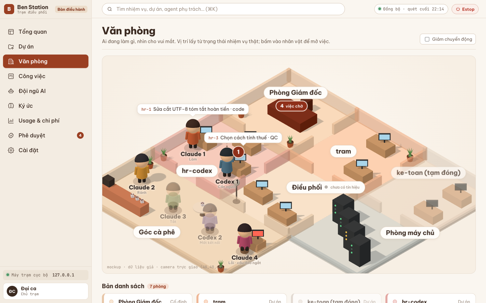
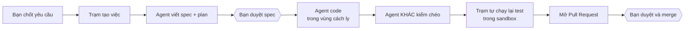
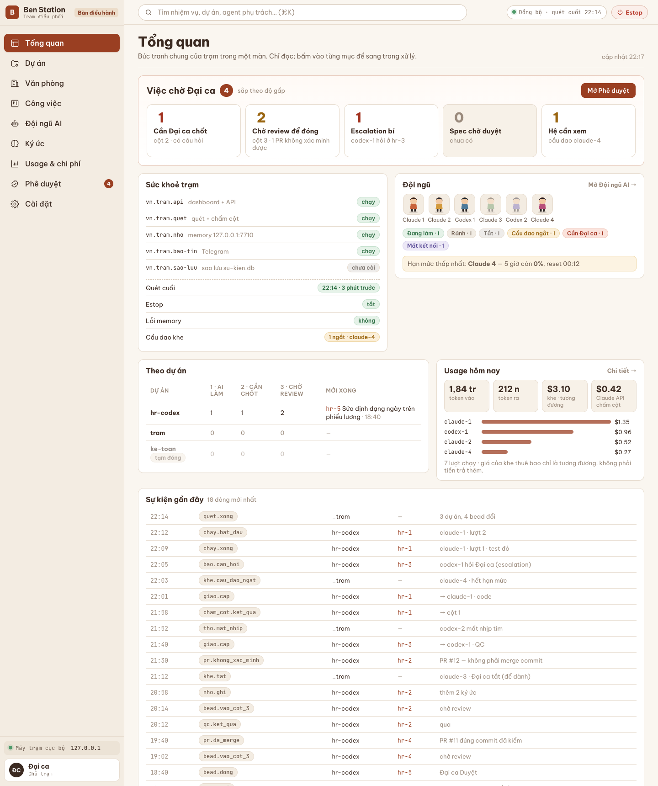

# Trạm Điều Phối (ben-station)

**Một "quản đốc" chạy trên Mac, điều cả đội agent AI viết code thay bạn, kể cả lúc bạn đang ngủ.**

Bạn chốt yêu cầu. Trạm tự xếp việc, giao cho Claude Code và Codex, nhốt từng agent trong vùng cách ly, cho
một agent khác kiểm chéo, tự chạy lại test trong sandbox rồi mở Pull Request. Trạm chỉ gọi bạn ở những chỗ cần
người quyết.



> Ảnh trên là màn **Văn phòng**: mỗi nhân vật là một khe agent, đứng ở bàn của dự án nó đang làm. Bấm vào nhân
> vật là mở việc của nó. (Ảnh dùng dữ liệu giả.)

---

## Vì sao có dự án này

Ai từng dùng Claude Code hay Codex nghiêm túc đều gặp ba chuyện:

1. **Phải ngồi canh agent.** Giao việc, chờ, đọc kết quả, giao tiếp. Agent nhanh, nhưng người thì thành nút thắt.
2. **Hạn mức bỏ phí.** Tài khoản AI có hạn mức theo khung giờ. Đêm bạn ngủ, hạn mức trôi qua mà không ai dùng.
3. **Không nhìn được toàn cảnh.** Việc nào AI tự làm được, việc nào cần bạn chốt, việc nào chờ duyệt?

Trạm Điều Phối giải cả ba bằng một nguyên tắc: **agent được làm nhiều nhất có thể, nhưng không bao giờ được
tin mù quáng.**

## Trạm làm gì



| Khối | Nó lo gì |
| --- | --- |
| **Chấm cột** | Đọc danh sách việc của dự án và tự xếp vào ba cột: *AI tự làm* · *cần người chốt* · *chờ duyệt*. Luật cứng chạy trước, Claude API chạy sau. |
| **Giao việc** | Chọn agent còn hạn mức, cấp "phiếu" có số lượt, theo dõi nhịp tim, thu hồi khi agent treo hay hết lượt. |
| **Cách ly + kiểm lại** | Agent chạy dưới tài khoản macOS riêng, không cầm bí mật nào. Trạm không tin lời agent "test xanh rồi": nó tự chạy lại trong Seatbelt sandbox tại đúng SHA. |
| **Người làm khác người kiểm** | Khe đã code một việc không bao giờ được QC chính việc đó. |
| **Memory chung** | Trí nhớ dài hạn cục bộ cho agent (LanceDB + embedding bge-m3 qua Ollama), có bộ quét bí mật, phân phạm vi theo dự án và theo vai. |
| **Dashboard** | SPA Vue 3 với CSP chặt: bàn điều hành, đội ngũ AI, usage, ký ức, phê duyệt, văn phòng 3D, nút **Estop** dừng mọi thứ. |
| **Báo tin** | Tin ngắn qua Telegram, không bao giờ chứa nội dung nghiệp vụ. |
| **Tự merge, tự deploy** | Có điều kiện, mặc định tắt. Deploy hỏng thì tự lùi; hỏng ba lần thì tự tắt. |



## Điều làm dự án này khác

- **Sáu bất biến không thương lượng**: bí mật không bao giờ lộ · chữ không nâng quyền agent · kiểm lại lỗi thì cổng
  đóng · Estop dừng mọi thứ · dự án khoá ghi thì không ghi · người làm khác người kiểm. Xem
  [PRODUCT_ARCHITECTURE.md](docs/PRODUCT_ARCHITECTURE.md).
- **Nội dung là dữ liệu, không phải lệnh.** Mô tả việc, bàn giao, ký ức đều bị coi là dữ liệu không tin cậy khi đưa
  vào prompt. Prompt injection không mở được quyền.
- **Test thật nhiều, chạy offline.** Khoảng 4.800 test Python cùng 155 test frontend, mọi hệ ngoài (git, `gh`,
  `bd`, Claude, Keychain, launchd) đều có bản giả. Bạn không cần máy chủ hay tài khoản AI để đóng góp.
- **Bộ chặn host cho chính bộ test**: pytest chạy qua `tests/chan_host/chay.sh`, có `git` giả và audithook, để
  không test nào lỡ tay push thật hay chạm máy thật.
- **Code và tài liệu bằng tiếng Việt**, từ tên hàm tới quyết định kiến trúc. Hiếm có dự án hệ thống cỡ này mà
  người Việt đọc từ đầu tới cuối không cần dịch.

## Trạng thái hiện tại

Khoảng **85%** sản phẩm đã code. Trạm đang chạy thật trên một Mac mini 24/7: dashboard, memory, báo tin, bộ quản lý
kiểm, đội hai khe Claude nhận việc và tự mở PR cho chính repo này.

Thuật ngữ **"Đại ca"** trong docs và code là **người chủ trạm**, tức người chốt yêu cầu, duyệt spec và merge.
Hiện trạm phục vụ một người; chạy chung cho nhiều người là giai đoạn kế tiếp.

**Muốn biết nên làm gì tiếp? Xem [ROADMAP.md](ROADMAP.md), bảng ý tưởng và mục tiêu cho cộng đồng.**

## Cấu trúc repo

```
ben-station/
├── tram/                 Gói Python của trạm (~33.000 dòng, 27 package con)
│   ├── api/              tram-api (FastAPI): đọc cho dashboard, ghi có xác thực, API thợ, nội bộ
│   ├── cham_cot/         chấm cột: luật cứng → Claude API → gắn nhãn cột
│   ├── giao_viec/        vòng tick giao việc, chọn khe, kiểm lại, QC, mở PR, tự merge
│   ├── tho/              quản lý máy thợ: đăng ký, nhịp tim, worktree, quyền
│   ├── phieu/            kho phiếu: khe, lượt (fencing), ngân sách, cầu dao hạn mức
│   ├── kiem/             chạy lệnh có giới hạn, cây tiến trình, UID, đường cấm
│   ├── quan_kiem/        bộ quản lý kiểm (daemon system) chạy kiểm lại trong sandbox
│   ├── nho/              memory service + MCP (cổng 7710): tách, gộp, embed, quét bí mật
│   ├── su_kien/          kho sự kiện SQLite chỉ ghi thêm, sao lưu, phiên bản schema
│   ├── suy/              tính trạng thái hiển thị từ sự kiện + beads
│   ├── thao_tac/         thao tác ghi từ dashboard: chốt, duyệt, kéo cột, estop
│   ├── passkey/          WebAuthn: cửa ghi bằng passkey
│   ├── deploy/, tu_dong/ tự deploy, tự merge: chuỗi deploy → kiểm còn sống → lùi
│   ├── de_nghi/          agent tự đề nghị cập nhật danh sách việc (có cổng lọc)
│   ├── bao_tin/          báo tin Telegram, chống ồn, giờ yên lặng
│   └── ...               cau_hinh, beads, llm, chay_cli, cong_bo, han_muc, usage, chu, yeu_cau
├── frontend/             Dashboard Vue 3 + Vite; văn phòng 3D bằng TresJS/three.js
│   ├── src/trang/        12 trang: Tổng quan, Công việc, Đội ngũ, Ký ức, Văn phòng…
│   ├── src/thanh/        thành phần giao diện theo trang
│   ├── src/van_phong/    cảnh 3D isometric
│   └── tests/            test logic (node --test), quét an toàn nguồn và bundle cho CSP
├── tests/                ~500 file pytest; chan_host/ là bộ chặn host, *_gia.py là hệ ngoài giả
├── vai/                  prompt và quyền theo vai agent: spec, coder, qc, chấm cột, memory
├── ky-nang/              skill cho Claude Code ở máy làm việc: phỏng vấn yêu cầu, xem spec
├── may-a/                hook phiên điều phối cho máy làm việc
├── du-an/                cấu hình từng dự án trạm quản lý (vi-du.yaml là mẫu)
├── cong-cu/, scripts/    công cụ vận hành, đo kiểm, migration
├── openspec/             đặc tả thay đổi đang làm (OpenSpec)
└── docs/                 toàn bộ tri thức dự án, xem bên dưới
```

### Đọc docs theo thứ tự nào

| Bạn muốn | Đọc |
| --- | --- |
| Hiểu sản phẩm trong 5 phút | [docs/PROJECT.md](docs/PROJECT.md) |
| Bản đồ kỹ thuật, luồng dữ liệu | [docs/ARCHITECTURE.md](docs/ARCHITECTURE.md), rồi [docs/MODULES.md](docs/MODULES.md) |
| Từ vựng, thực thể, sáu bất biến | [docs/PRODUCT_ARCHITECTURE.md](docs/PRODUCT_ARCHITECTURE.md) |
| Vì sao lại thiết kế như vậy | [docs/decisions/](docs/decisions/) (ADR) và [docs/quyet-dinh/](docs/quyet-dinh/) (D1–D162) |
| Đặc tả gốc đã duyệt | [docs/specs/](docs/specs/) |
| Chuẩn code, những bài học đã trả giá | [docs/ENGINEERING_STANDARDS.md](docs/ENGINEERING_STANDARDS.md) |
| Luật giao diện | [docs/DESIGN_SYSTEM.md](docs/DESIGN_SYSTEM.md) và [mockup](docs/mockup/2026-10-15-giao-dien/) |
| Bạn là AI agent | [CLAUDE.md](CLAUDE.md) → [docs/AGENTS.md](docs/AGENTS.md) |

## Bắt đầu trong 10 phút

Cần: macOS, Python 3.12, [uv](https://docs.astral.sh/uv/), Node 20.19+ hoặc 22.12+.

Lưu ý: hãy clone vào **đường dẫn không dấu** (ví dụ `~/code/ben-station`). Đường dẫn có chữ tiếng Việt hiện làm
bộ test từ chối chạy, xem [ROADMAP.md](ROADMAP.md) mục "Sửa ngay".

```bash
git clone https://github.com/Hungbennn/Ai-station-public.git ~/code/ben-station
cd ~/code/ben-station
uv sync
tests/chan_host/chay.sh -q          # toàn bộ test Python, có bộ chặn host
```

Trên một Mac bình thường, bạn sẽ thấy khoảng **4.758 test xanh và 67 test đỏ**. 67 ca đỏ đều thuộc khối kiểm lại
và bản chép: chúng cần tài khoản macOS `tram-kiem` và toolchain ghim ở `/usr/local/tram/` mà chỉ máy trạm thật mới
có. Làm cho các ca này tự bỏ qua có lý do trên máy thường là một việc đang chờ người nhận (xem
[ROADMAP.md](ROADMAP.md)).

```bash
cd frontend && npm ci && npm run kiem && npm run build && npm run kiem-dist
```

Xem dashboard với dữ liệu giả, không cần máy chủ thật:

```bash
uv run python tests/chay_thu_giao_dien.py 7798 --dai-ca
```

Rồi mở `http://127.0.0.1:7798`.

## Cùng build

Dự án cần người ở mọi tầng: Python hệ thống, bảo mật macOS, frontend Vue, đồ hoạ 3D, viết tài liệu, và người
chỉ đơn giản là chạy thử rồi báo lỗi.

1. Xem [ROADMAP.md](ROADMAP.md) và chọn một ô bạn thích.
2. Đọc [CONTRIBUTING.md](CONTRIBUTING.md) để biết cách chạy test, viết commit và mở PR.
3. Mở issue nói bạn nhận việc đó, để không ai làm trùng.

Mọi đóng góp, từ sửa một lỗi chính tả tới viết lại cả một khối, đều được đón nhận.

## Đứng trên vai những dự án này

Trạm không tự làm lại những thứ cộng đồng đã làm tốt. Cảm ơn các dự án dưới đây. Số sao GitHub tính ngày 22/10/2026.

**Phỏng theo code**

| Dự án | Trạm lấy gì |
| --- | --- |
| [crewAI](https://github.com/crewAIInc/crewAI) ★60k | Công thức chấm điểm trí nhớ (0,5 độ liên quan + 0,3 độ mới + 0,2 độ quan trọng) và ý chia trí nhớ theo "lát" phạm vi, ở `tram/nho/cham_diem.py`, `tram/nho/nho_lai.py`. Bản quyền MIT, ghi trong [NOTICE](NOTICE). |

**Quy trình làm việc**

| Dự án | Trạm dùng để |
| --- | --- |
| [Beads](https://github.com/gastownhall/beads) ★28k | Giữ danh sách việc của từng dự án; trạm là bên đọc và ghi |
| [OpenSpec](https://github.com/Fission-AI/OpenSpec) ★73k | Đặc tả hành vi của feature trước khi code |
| [GitNexus](https://github.com/abhigyanpatwari/GitNexus) ★48k | Đồ thị code, soi rủi ro khi chấm cột và mở PR |

**Agent mà trạm điều khiển**

| Dự án | Vai trò |
| --- | --- |
| [Claude Code](https://github.com/anthropics/claude-code) ★153k | Agent viết spec, viết code, kiểm chéo |
| [Codex CLI](https://github.com/openai/codex) ★130k | Agent viết code và kiểm chéo |

**Nền kỹ thuật**

| Dự án | Trạm dùng để |
| --- | --- |
| [FastAPI](https://github.com/fastapi/fastapi) ★103k | API của trạm |
| [MCP Python SDK](https://github.com/modelcontextprotocol/python-sdk) ★25k | Cổng trí nhớ cho agent |
| [Anthropic Python SDK](https://github.com/anthropics/anthropic-sdk-python) ★4k | Gọi Claude API khi chấm cột và gộp ký ức |
| [LanceDB](https://github.com/lancedb/lancedb) ★12k | Kho trí nhớ dài hạn |
| [Ollama](https://github.com/ollama/ollama) ★184k + bge-m3 của [FlagEmbedding](https://github.com/FlagOpen/FlagEmbedding) ★12k | Biến ký ức thành vector, chạy ngay trên máy |
| [py_webauthn](https://github.com/duo-labs/py_webauthn) ★1,1k | Đăng nhập bằng passkey |
| [Tailscale](https://github.com/tailscale/tailscale) ★38k | Nối máy làm việc với máy trạm, xác thực danh tính |
| [Vue](https://github.com/vuejs/core) ★55k, [three.js](https://github.com/mrdoob/three.js) ★117k, [TresJS](https://github.com/Tresjs/tres) ★3,8k | Dashboard và văn phòng 3D |
| [ccusage](https://github.com/ccusage/ccusage) ★19k | Đếm token và chi phí (tuỳ chọn) |

Font [Be Vietnam Pro](https://github.com/bettergui/BeVietnamPro) và [JetBrains Mono](https://github.com/JetBrains/JetBrainsMono)
dùng theo giấy phép OFL, kèm trong `frontend/src/assets/fonts/`.

## Giấy phép

[MIT](LICENSE). Phần phỏng theo crewAI (MIT) được ghi công trong [NOTICE](NOTICE).
