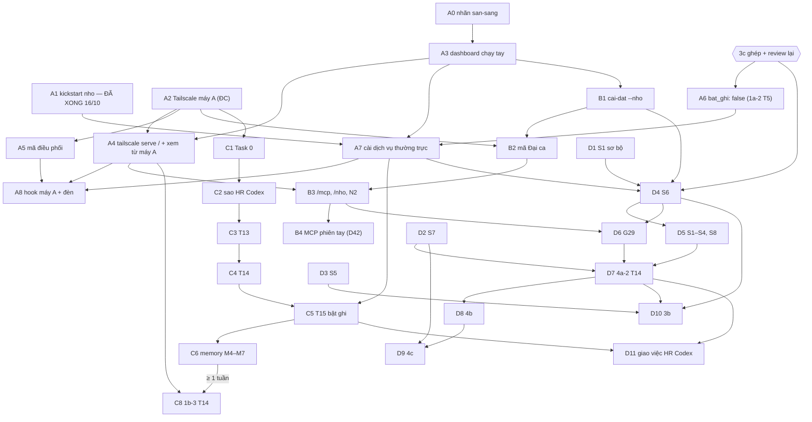

# Sổ tay giai đoạn chạy thật — bản 2 (16/10/2026)

> **Review đợt 6:** S6/D4 giữ ĐÓNG; C01 cách ly liên lượt, C02 cleanup harness/UID, R7 và `bs-78r.10` còn chặn. T11 đã có sửa văn bản về mã lỗi dọn, chưa triển khai. Không chạy kịch bản cron/at/launchd thật từ test/agent trên user Đại ca. Không xem daemon-thread timeout là đã thu hồi tác vụ. Báo cáo đợt 6 phân biệt kết quả bàn giao và chứng cứ tĩnh.

Status: `ACTIVE` · Bead: `bs-78r.4` · Epic các việc chạy thật: `bs-8eh` · Nền mã: `main` `bd9c376`

Sổ tay này là **một đường găng** cho giai đoạn chạy thật. Đọc theo thứ tự:

1. **Nhật ký** — việc đã làm thật, hiện trạng máy.
2. **§1 Quy ước** — áp cho mọi bước.
3. **§2 Đại ca chuẩn bị trước** — việc làm được ngay, không chờ mã.
4. **§3 Đường găng** — từng bước theo thứ tự, có điều kiện trước, người làm, lệnh, tiêu chí đạt, đường lui, bead.
5. **Phụ lục** — quyết định còn mở, rủi ro, ghi chép bản 1.

Bản 1 (15/10) còn trong git: `git show f5b1fdb:docs/handovers/2026-10-15-so-tay-chay-that.md`. Quyết định D1–D44 ở [`../quyet-dinh/2026-10-15-chot-dot-4.md`](../quyet-dinh/2026-10-15-chot-dot-4.md) giữ nguyên. Chỗ nào chưa rõ ghi **"chưa rõ — cần Đại ca"**.

> **Chặn bởi 3c.** Review Codex đợt 5 (16/10): plan 3c chưa sẵn sàng (C01, Q01–Q03; R4–R7 của plan 3c). 3c đang được sửa. **S6 vẫn đóng.** `tram giao tick --thu` không chạy pha kiểm lại, nên không dùng làm bằng chứng S6. Mọi bước có nhãn **[chờ 3c]** chưa được chạy. Sổ tay chỉ dẫn chiếu plan 3c Task 9, không chép lại chi tiết 3c. D22 đã bỏ helper root; D34 chốt `cong_bo.phuong_an: lai` (đã ghép R3); D40 chốt các câu mở của plan.

## Nhật ký chạy thật

Mỗi việc đã làm thật trên máy ghi một dòng. Mới nhất ở dưới. Làm xong một bước của đường găng thì thêm dòng ở đây.

| Ngày | Việc | Ai | Kết quả | Nguồn |
|---|---|---|---|---|
| 13/10 | Đăng nhập Tailscale máy B | ĐC | Máy B vào tailnet: `may-b.tailnet-vi-du.ts.net` | `bs-g28.9` (đóng) |
| 13–15/10 | Cài Ollama + bge-m3, `vn.tram.nho`, `vn.tram.bao-tin`; kiểm M1/M2 và recall thật | ĐC cho phép, Em chạy | Đạt | ghi chú `bs-hpc.5` |
| 15/10 | Kiểm hiện trạng máy B; sổ tay bản 1; Đại ca chốt D1–D16 | Em, ĐC | Xem mục "Hiện trạng" | sổ tay bản 1 (`f5b1fdb`) |
| 16/10 | Ghép 1b-4 Task 0–4 vào `main` (`a3587da`) | Em | Xanh | `bs-za9.2.1`–`.5` |
| 16/10 | 1b-4 Task 5 Step 1 (chỉ đọc): đọc mốc `moc_nho`, đếm sự kiện phần 4 | Em | **Kho sự kiện trống**: 0 sự kiện `kiem.lai`, `qc.ket_qua`, `escalation.dong`, `spec.tra_ve`. Không nguồn nào bị mốc vượt (G18) | plan 1b-4 Task 5 |
| 16/10 | 1b-4 Task 5 Step 2 — **kickstart D11**: `launchctl kickstart -k gui/$(id -u)/vn.tram.nho` | Em (D11 đã cho phép) | `vn.tram.nho` chạy mã 1b-4. Làm **trước** khi cài `vn.tram.api`, đúng D11 | plan 1b-4 Task 5; D11 |
| 16/10 | Ghép 2d, 2e (Task 1–4, 6), 1a-2 (Task 1–3), 2f (Task 1–18) | Em | 2f Task 18 kiểm trên trình duyệt với dữ liệu giả (cổng 7798): đạt. Chưa kiểm: bàn phím đầy đủ, không WebGL, giảm chuyển động | "Ghi chú triển khai" plan 2f-2 |
| 16/10 | Review Codex đợt 5 | Codex | 3c chưa sẵn sàng (C01, Q01–Q03). S6 vẫn đóng | `2026-10-16-phan-hoi-review-codex-dot5.md` |
| 16/10 | Đại ca chốt D42: MCP phiên tay máy A dùng `claude mcp add --scope local` | ĐC | Bước B4 | quyết định 15/10, D42 |

Còn nợ: "Ghi chú triển khai" của plan 1b-4 Task 5. Viết sau Step 3–4 (bước C7), theo Step 5 của task.

### Hiện trạng (16/10)

Em kiểm chỉ đọc trên máy B, trừ chỗ ghi khác.

- **Dịch vụ:** chỉ có LaunchAgent `vn.tram.bao-tin` và `vn.tram.nho`. Chưa cài `vn.tram.api`, `vn.tram.quet`, `vn.tram.sao-luu`. Không có LaunchDaemon `vn.tram.*`.
- **Keychain máy B** (kiểm 15/10): có `tram-telegram-bot-token`, `tram-anthropic-api-key`, `tram-nho-token`. **Chưa có** `tram-noi-bo-token`.
- **`~/.tram/cau-hinh.yaml`:** chỉ có khối `telegram`. Chưa có `dai_ca_logins`, `ten_may_b`, `dashboard_url`.
- **Công cụ máy B:** có `tailscale`, `gh`, `claude`, `bd`, `uv`, `node`, `ollama`, `gitnexus`. Chưa có `dolt`, `ccusage`. `codex`: `/opt/homebrew/bin/codex` trỏ vào `ChatGPT.app`, nhưng `which codex` không thấy (16/10).
- **Máy A:** chưa có Tailscale (D6). HR Codex chỉ có ở máy A. Repo trạm chưa có remote.
- **Mã trên `main` (`bd9c376`):** đã ghép 1b-4 Task 0–4; 2d; 2e Task 1–4, 6; 1a-2 Task 1–3; 2f Task 1–18. **Chưa ghép:** 3c Task 1, 3, 5–8, 10 (`bs-za9.1`); 1a-2 Task 4–6 (`bs-za9.4.4`–`.6`, chờ 3c vì cùng sửa `tram/giao_viec/noi_that.py`).
- **#5 mở một phần** (bảng ở quyết định 13/10, mục "Ghi chú 15/10"). **Chưa duyệt:** spike S1–S8 gọi CLI thật; tạo user macOS/sudoers (S6); repo GitHub (S7); mã Đại ca trên máy A; bật giao việc; mọi bước tốn quota.

---

## 1. Quy ước (áp cho mọi bước)

| Quy ước | Nguồn |
|---|---|
| **Bí mật** (token, mã Đại ca, mã điều phối, mật khẩu `sudo`) chỉ do **Đại ca dán trong Terminal.app, vào ô ẩn** (`getpass`, `security … -w`). Không dùng khung terminal của app Claude: khung này làm hỏng chuỗi dán vào ô ẩn. | memory; 1b-2 T10; 2e HUONG-DAN |
| **Không bao giờ** đưa bí mật vào argv (`ps` thấy), file, log, biến môi trường cố định, chat hay ảnh chụp. Lệnh đọc Keychain dùng ống hoặc `$(…)`, không chép giá trị ra màn hình. Ngoại lệ duy nhất có ghi rủi ro: biến `TRAM_DAI_CA_MA` của phiên tay (bước B4). | spec 1b G13; D24 |
| **Tạo mã** bằng `openssl rand -hex 32 \| tr -d '\n' \| pbcopy` (vào clipboard, không hiện ra; `tr` bỏ dấu xuống dòng). Dán xong thì xoá clipboard: `pbcopy < /dev/null`. Mỗi mã tạo mới; không dùng lại mã cũ cho mục khác. | 2e HUONG-DAN |
| Agent **không** gõ `dong-y` thay Đại ca, không nhập bí mật, không đăng nhập Tailscale/GitHub/CLI, không cài gì trên máy A, không sửa `~/.claude` của Đại ca. | 2a T26; 2e T5; Q15 |
| Mỗi spike ghi `docs/spikes/<ngày>-<tên>.md`: phiên bản, lệnh, môi trường, mã thoát, transcript **đã che bí mật**. | spec 3 §12 |
| Không đánh dấu sẵn sàng bằng fixture giả. `tram tho kiem` và `tram giao kiem` phải XANH khi chạy thật. | spec 3 §3 mục 3 |
| Kết quả lệch giả định → sửa đúng adapter plan chỉ ra, có test dùng dòng thật đã che. Không sửa tay trên máy. | 3a-2 "Để sau" |
| Một bước sai → **dừng ngay**, làm theo "Lùi" của bước đó. Không nhảy sang bước sau. | mọi plan |
| Xong mỗi bước: thêm "Ghi chú triển khai" vào cuối plan tương ứng (commit riêng), cập nhật bead, thêm một dòng vào **Nhật ký**. | mọi plan |
| Bước **[chờ 3c]** không chạy cho tới khi 3c ghép, qua review lại, và điều kiện riêng của bước đạt. | review Codex đợt 5 |
| Bước **[tốn]** gọi API hoặc quota gói: chỉ chạy khi Đại ca đã duyệt khoản đó (§2 mục 13). | #5 |

Cột **Ai**: **ĐC** = Đại ca tự tay · **Em** = Em, người điều phối hoặc subagent · **ĐC+Em** = làm chung.

---

## 2. Đại ca chuẩn bị trước

Việc Đại ca làm được ngay, không chờ mã. Mỗi việc một dòng. Làm xong thì ghi vào Nhật ký.

1. Cài Tailscale trên máy A, đăng nhập cùng tailnet với máy B (D6, `bs-8eh.17`; chính là bước A2).
2. Máy A: `/usr/bin/python3 --version` phải ≥ 3.9; macOS hỏi cài Command Line Tools thì cài (hook A8 cần).
3. Máy B: tắt ngủ trong System Settings → Energy.
4. Máy B: bật tự đăng nhập sau khởi động lại, để Keychain mở cho `vn.tram.nho`.
5. Chọn cách chép thư mục từ máy B sang máy A (AirDrop, hoặc bật Remote Login trên B rồi `scp` qua tailnet). Cần cho hook (A8) và skill 4b (D8).
6. Máy B: thêm vào `~/.tram/cau-hinh.yaml` các khoá `dai_ca_logins` (login Tailscale của Đại ca), `ten_may_b` (tên máy B trong tailnet), `dashboard_url` (`https://…`); kiểm `telegram.chat_id`. Mẫu ở plan 2a Task 5.
7. Máy B: kiểm `gh auth status` và `claude` đã đăng nhập chưa.
8. Máy B: kiểm `codex --version` (16/10 `which codex` không thấy). Cần cho S5.
9. Tạo repo GitHub **nháp** (S7, 2a D1–D6, 4a-2): branch protection nhánh chính, chỉ cho "Create a merge commit".
10. Quyết repo GitHub riêng của trạm: có hay không, tên gì (`bs-8eh.14`).
11. Sẵn hai tài khoản Claude cho `B/claude-1` và `B/claude-2` (D5).
12. Trả lời phần #5 chưa duyệt: spike S1–S8; user macOS/sudoers (S6); repo GitHub (S7); mã Đại ca trên máy A; bật giao việc; bước tốn quota.
13. Duyệt chi phí: 0+1a Task 14 < 5 USD API; M4 vài nghìn token Haiku; quota cho S1–S8, 4a-2, 4b, 4c (chưa có số).
14. Chọn tên mục Keychain máy A cho mã Đại ca (plan 1b-2 chưa đặt; Em đề xuất `tram-dai-ca-ma`).
15. Quyết có chấp nhận rủi ro mã Đại ca nằm trong môi trường phiên Claude Code trên máy A không (bước B4, D42).
16. Chọn nạp lịch sử memory (a) hay chỉ từ bây giờ (b) (Phụ lục A, mục 4.9). Cần trước M4.
17. Soạn sẵn 20 truy vấn M5 cho memory (`bs-8eh.12`).
18. Xem "Gợi ý gỡ chặn 3c" (§3.3) và chốt có làm không.

---

## 3. Đường găng

### 3.1 Bảng tóm tắt

Đọc từ trên xuống. **Trước** = bước phải đạt trước. **[chờ 3c]** = chưa chạy được. **[tốn]** = gọi API hoặc quota.

| Bước | Việc | Ai | Trước | Chặn | Bead |
|---|---|---|---|---|---|
| A0 | Gắn nhãn `san-sang` cho bead cổng (D41 G13) | Em | Đại ca bảo "bắt đầu" | — | `bs-8eh` |
| A1 | Kickstart `vn.tram.nho` (D11) | Em | ghép 1b-4 T4 | **Đã xong 16/10** | `bs-za9.2` |
| A2 | Cài + đăng nhập Tailscale máy A (D6) | ĐC | — | — | `bs-8eh.17` |
| A3 | Dashboard chạy tay, kiểm cục bộ | ĐC+Em | A0, §2 mục 6 | — | `bs-6o0.11` |
| A4 | `tailscale serve /`, xem dashboard mới từ máy A | ĐC+Em | A2, A3 | — | `bs-6o0.11`, `bs-8eh.16` |
| A5 | Đặt mã điều phối (D24) | ĐC | A2 hoặc ngồi máy B | — | `bs-za9.5` |
| A6 | `bat_ghi: false` cho HR Codex (ghép 1a-2 T5) | Em | 3c ghép | **[chờ 3c]** | `bs-za9.4.5` |
| A7 | Cài dịch vụ thường trực, có `vn.tram.api` | ĐC | A1, A3, A6 | **[chờ 3c]** qua A6 | `bs-6o0.11` |
| A8 | Cài hook máy A, kiểm đèn Điều phối | ĐC+Em | A4, A5, A7 | **[chờ 3c]** qua A7 | `bs-za9.5` |
| B1 | `tram chu cai-dat --nho`: tạo `tram-noi-bo-token` | ĐC | A3 | — | `bs-8eh.1` |
| B2 | Mã Đại ca: Keychain máy A, bản băm máy B | ĐC | A2, B1, #5 duyệt | chờ ĐC duyệt | `bs-8eh.1` |
| B3 | Kiểm `/mcp`, `tailscale serve /nho`, spike N2 | ĐC+Em | B2, A4 | — | `bs-8eh.1` |
| B4 | MCP memory phiên tay máy A (D42) | ĐC | B3 | ĐC chấp nhận rủi ro | `bs-8eh.1`, `bs-urj.5` |
| C1 | 0+1a Task 0: spike beads từ xa | ĐC+Em | A2 | — | `bs-g28.4` |
| C2 | Sao HR Codex sang B, sửa `duong_dan` (D1) | Em | C1 đạt | — | `bs-g28.4` |
| C3 | Task 13: 20 bead mẫu | ĐC+Em | C2 | — | `bs-g28.5` |
| C4 | Task 14: đánh giá, chấm thử | Em, ĐC chấm | C3 | **[tốn]** < 5 USD | `bs-g28.6` |
| C5 | Task 15: bật ghi HR Codex trên B | ĐC+Em | C4 duyệt, A7 | **[chờ 3c]** qua A6/A7 | `bs-g28.7` |
| C6 | Memory 1b-1 phần còn lại (M4–M7) | Em, ĐC đọc | C5 | **[tốn]** Haiku | `bs-hpc.5`, `bs-8eh.12` |
| C7 | 1b-4 Task 5 Step 3–4 | Em, ĐC đọc | có sự kiện phần 4 thật | **[tốn]** | `bs-za9.2` |
| C8 | 1b-3 Task 14: thăng cấp, màn Ký ức | ĐC+Em | C6 ổn ≥ 1 tuần, A4 | chờ thời gian | `bs-8eh.2` |
| D1 | S1 sơ bộ dưới user hiện tại (D2) | ĐC+Em | #5 duyệt spike | **[tốn]** ít | `bs-8eh.3` |
| D2 | S7: repo nháp, công bố lai (D4, D34) | ĐC+Em | §2 mục 9 | — | `bs-8eh.5`, `bs-8eh.14` |
| D3 | S5: Codex thật | ĐC+Em | §2 mục 8 | **[tốn]** | `bs-8eh.6` |
| D4 | S6: principal, cách ly (plan 3c Task 9) | ĐC+Em | 3c, D1, B1, A7 | **[chờ 3c]** | `bs-8eh.4` |
| D5 | S1–S4, S8 dưới principal | ĐC+Em | D4 | **[chờ 3c]** **[tốn]** | `bs-8eh.3` |
| D6 | G29 kênh ghi Unix socket; 2e T5 Step 2b | ĐC+Em | D4, B3 | **[chờ 3c]** | `bs-8eh.15` |
| D7 | 4a-2 Task 14: repo nháp 3 bug | ĐC+Em | D2, D5, D6, B1 | **[chờ 3c]** **[tốn]** | `bs-8eh.7` |
| D8 | 4b: skill máy A, feature thật | ĐC+Em | D7, A2 | **[chờ 3c]** **[tốn]** | `bs-8eh.9` |
| D9 | 4c: GN, PR thật | ĐC+Em | D8, D2 | **[chờ 3c]** **[tốn]** | `bs-8eh.10` |
| D10 | 3b: Mac thợ từ xa | ĐC+Em | D3, D4, D7, Q15 | **[chờ 3c]** **[tốn]** | `bs-8eh.8` |
| D11 | Bật giao việc trên HR Codex | ĐC | D7, C5 | **[chờ 3c]** | chưa có bead |
| E1 | Cài ccusage | ĐC cho tải, Em | — | — | `bs-8eh.13` |

**Đường găng dài nhất:** 3c → D4 (S6) → D5 → D6 → D7 → D8 → D9. **Chuỗi có chờ thời gian:** C1 → C5 → C6 → (≥ 1 tuần) → C8. Hai chuỗi chạy song song. Không chờ 3c: A0–A5, B1–B4, C1–C4, C7 (khi có sự kiện), D1–D3, E1.

### 3.2 Sơ đồ



### 3.3 Gợi ý gỡ chặn 3c (chưa chốt — cần Đại ca)

1. A6, A7, A8 và C5 chỉ chờ 3c vì 1a-2 Task 5 sửa chung `tram/giao_viec/noi_that.py` với 3c Task 3/5. Nếu tách phần `bat_ghi` của `tram quet --ghi` và bản vá `du-an/hr-codex.yaml` ra ghép trước, bốn bước này thôi chờ 3c. Phần bộ giao việc (`noi_that.py`) ghép sau 3c. Việc này đổi plan 1a-2, cần duyệt và review.
2. A8 có thể làm với API chạy tay của A3. Plan 2e Task 5 Step 1 ghi cổng là `vn.tram.api` đã cài. Làm sớm thì kết quả chỉ tạm; kiểm lại Step 4 sau A7.

### 3.4 Chi tiết từng bước

#### A0 — Gắn nhãn `san-sang` cho bead cổng (D41 G13)

- **Trước:** Đại ca bảo "bắt đầu" đợt chạy thật.
- **Ai:** Em (người điều phối).
- **Lệnh** (repo trạm, máy B):
  ```bash
  cd "/Users/dai-ca/Developer/Ben Station"
  bd label add bs-8eh.17 bs-6o0.11 bs-8eh.16 bs-8eh.1 bs-g28.4 bs-g28.5 bs-g28.6 bs-g28.7 \
    bs-hpc.5 bs-8eh.12 bs-8eh.2 bs-8eh.3 bs-8eh.4 bs-8eh.5 bs-8eh.6 bs-8eh.7 bs-8eh.8 \
    bs-8eh.9 bs-8eh.10 bs-8eh.14 bs-8eh.15 bs-8eh.13 san-sang
  bd list --label san-sang --limit 0
  ```
  Có thể gắn thêm `bs-za9.4.5` (A6) và `bs-za9.5` (A5, A8) để bảng thấy các bước này.
- **Đạt:** `bd list --label san-sang` ra đủ 22 bead con đang mở của `bs-8eh`. Sau A3, trang Cài đặt → "Bảng sẵn sàng" hiện các bead này (đóng = đạt; mở = thiếu; mở và có `blocks` chưa đóng = chờ), cộng mục tự kiểm (lệnh trong PATH, dịch vụ, Keychain).
- **Lùi:** `bd label remove <id> san-sang`.
- **Ghi chú:** bảng chỉ đọc bead của repo trạm, chỉ hiện tiêu đề. Bead cổng hiện chưa có quan hệ `blocks`, nên bảng hiện "thiếu", không hiện "chờ". Thêm `blocks` theo §3.1 là tuỳ chọn, Đại ca quyết.
- **Bead:** `bs-8eh`.

#### A1 — Kickstart `vn.tram.nho` (D11) — **ĐÃ XONG 16/10**

- **Trước:** ghép 1b-4 Task 4; **trước** khi cài `vn.tram.api` hay bật giao việc.
- **Ai:** Em (D11 đã cho phép: restart dịch vụ đã bật).
- **Lệnh:** 1b-4 Task 5 Step 1 (hai lệnh `sqlite3 -readonly`), Step 2 `launchctl kickstart -k gui/$(id -u)/vn.tram.nho`; `tail -n 5 ~/.tram/log/nho.log`.
- **Đạt:** dịch vụ lên lại, chỉ nghe `127.0.0.1:7710`, log không lỗi import. Kết quả 16/10 ở Nhật ký: kho sự kiện trống.
- **Lùi:** sau reboot Keychain khoá → Đại ca đăng nhập rồi kickstart lại. Mã mới không lên → giữ API/giao việc chưa bật, khôi phục bản dịch vụ trước đã biết tốt rồi restart; không tự đặt lại mốc, không nạp lại.
- **Còn lại:** Step 3–4 ở C7.
- **Bead:** `bs-za9.2`.

#### A2 — Đại ca cài và đăng nhập Tailscale máy A (D6)

- **Trước:** không.
- **Ai:** ĐC. Agent không cài, không đăng nhập.
- **Lệnh:** cài Tailscale trên máy A, đăng nhập tài khoản tailnet của máy B. Kiểm: `tailscale status` trên hai máy; từ máy A `tailscale ping <ten_may_b>`.
- **Đạt:** máy A và máy B thấy nhau trong tailnet.
- **Lùi:** mọi bước cần máy A dừng (A4 phần máy A, A5 qua `ssh`, A8, B2–B4, C1, D8). Bước chỉ cần máy B vẫn đi.
- **Bead:** `bs-8eh.17`.

#### A3 — Dashboard chạy tay, kiểm cục bộ (2a Task 26 Step 1–4, 6)

- **Trước:** A0; §2 mục 6 (cấu hình). Không cài dịch vụ nào.
- **Ai:** ĐC (cấu hình, xem giao diện); Em (build, chạy API, lệnh kiểm; Đại ca cho phép chạy thật).
- **Lệnh** (máy B):
  ```bash
  cd "/Users/dai-ca/Developer/Ben Station"
  (cd frontend && npm ci && npm run kiem && npm run build && npm run kiem-dist)   # npm ci tải gói đã ghim: cần mạng
  uv run tram api          # cửa sổ Terminal riêng, giữ chạy; giao_viec.bat mặc định tắt
  ```
  Cửa sổ khác:
  ```bash
  curl -sI http://127.0.0.1:7700/ | grep -i -e content-security-policy -e '^server'
  curl -s -o /dev/null -w '%{http_code}\n' -H 'Host: evil.example:7700' http://127.0.0.1:7700/api/du-an
  curl -s -o /dev/null -w '%{http_code}\n' -X POST -H 'Content-Type: application/json' -H 'X-Tram: 1' \
    -d '{"ma_thao_tac":"ma-thu-cuc-bo-1","expected_version":"tat"}' http://127.0.0.1:7700/api/chu/estop
  lsof -nP -iTCP:7700 -sTCP:LISTEN
  ```
  (ĐC) mở `http://127.0.0.1:7700/#/tong-quan` trên máy B, đi qua chín trang, mở Console. Tuỳ chọn: kiểm cờ `bd` có giá trị bắt đầu bằng `-` trên DB tạm (2a T26 Step 6).
- **Đạt:** có CSP đúng spec, không có header `server`; Host lạ → 421; POST không danh tính → 403; chỉ nghe `127.0.0.1`; chín trang hiện "Chỉ đọc · không có danh tính Đại ca"; Console không có dòng CSP.
- **Lùi:** Ctrl-C dừng API, không ảnh hưởng `nho`, `bao-tin`. Lỗi CSP → không nới CSP, báo lại. Host khác dự kiến → bổ sung `host_hop_le` (2a Task 10), không tắt kiểm Host.
- **Không** chạy `uv run tram chu cai-dat` ở đây (lý do ở A7).
- **Bead:** `bs-6o0.11`.

#### A4 — Mở dashboard mới qua tailnet từ máy A (2a Task 26 Step 7–8; phần còn lại của 2f Task 18)

- **Trước:** A2; API đang chạy (A3 chạy tay, hoặc A7).
- **Ai:** ĐC (`tailscale serve`, kiểm tay trên máy A và điện thoại); Em (đọc log, ghi kết quả).
- **Lệnh:**
  1. (ĐC, máy B) `tailscale serve --bg --https=443 http://127.0.0.1:7700` (lệnh `tram chu cai-dat` in sẵn; kiểm cú pháp với bản Tailscale trên máy B).
  2. (ĐC, máy A) mở `https://<ten_may_b>/#/tong-quan`: thẻ "Đại ca · Chủ trạm", nút Estop bật được (`la_dai_ca: true`).
  3. Từ thiết bị gắn tag hoặc người khác trong tailnet: `curl -s https://<ten_may_b>/api/chu/trang-thai` → `la_dai_ca: false`; thêm `-H 'Tailscale-User-Login: <login Đại ca>'` → **vẫn** `false`. Không có thiết bị như vậy → ghi "chưa kiểm được" và chưa dùng dashboard để ghi.
  4. Host mà `tailscale serve` gửi tới 7700 phải là `<ten_may_b>` hoặc `<ten_may_b>:443` (G17).
  5. Phần 2f Task 18 còn thiếu, trên máy A và điện thoại: Tab qua menu, ô tìm ⌘K/Ctrl+K, thẻ bead (Enter mở ngăn bên), nhãn Văn phòng, bản danh sách phòng; 375 px; Văn phòng khi tắt WebGL; "Giảm chuyển động" của hệ điều hành.
  6. Trang Cài đặt: bảng sẵn sàng có bead `san-sang` (A0) và mục tự kiểm; Keychain chỉ hiện có/chưa.
  7. 2a D1–D6 trên repo nháp (§2 mục 9), **không** dùng HR Codex (bảng ở plan 2a Task 26 Step 8).
  8. Kiểm tay Đội ngũ AI, Usage, Văn phòng 3D qua tailnet (`bs-8eh.16`).
- **Đạt:** từ máy A `la_dai_ca: true`; header giả từ thiết bị khác vẫn `false`; Host đúng; chín trang không lỗi Console; D1 `lệch: []`, D2 thẻ đổi ≤ 10 s, D3 có `cot-khoa` + `cot.dai_ca_sua` có `vi_sao`, không trùng, D4 POST lạ → 403, D5 tin Telegram ≤ 2 phút có gom, D6 ≤ 2 s.
- **Lùi:** header giả cho `true` → **dừng**, không dùng dashboard để ghi; chuyển "mã truy cập dài + cookie" (spec 2 §4 mục 2, cần bổ sung spec). Gỡ đường serve: `tailscale serve reset` (kiểm cú pháp). Chốt > 10 s → ghi "Ghi chú triển khai", tối ưu sau. Lỗi giao diện → ghi bead, sửa ở lát giao diện.
- **Bead:** `bs-6o0.11`, `bs-8eh.16`.

#### A5 — Đặt mã điều phối (D24; 2e Task 5 Step 3, phần "Tạo mã")

- **Trước:** lệnh `tram chu dat-ma-dieu-phoi` đã có trên `main` (2e Task 6). A2 nếu dán từ máy A qua `ssh`. Không cần API.
- **Ai:** ĐC. Agent không nhìn, không gõ, không in mã.
- **Lệnh** (theo `may-a/hook-dieu-phoi/HUONG-DAN.md`; mọi lệnh trong **Terminal.app**):
  1. Máy A: `openssl rand -hex 32 | tr -d '\n' | pbcopy` — mã vào clipboard, không hiện ra.
  2. Máy A: `security add-generic-password -s tram-dieu-phoi-ma -a "$USER" -w` — dán vào ô ẩn, hai lần.
  3. Máy B (ngồi tại máy B, hoặc `ssh` từ Terminal.app máy A): `cd "/Users/dai-ca/Developer/Ben Station" && uv run tram chu dat-ma-dieu-phoi` — gõ `dong-y`, dán vào ô ẩn hai lần.
  4. Máy A: `pbcopy < /dev/null`.
- **Đạt:** máy B `grep -c dieu_phoi_ma_sha256 ~/.tram/cau-hinh.yaml` = 1 (chỉ bản băm). Máy A `security find-generic-password -s tram-dieu-phoi-ma >/dev/null; echo $?` = 0 (không dùng `-w`).
- **Lùi:** lệnh báo lỗi → không đổi gì, làm lại. Nghi lộ mã → làm lại bước 1–4 với mã mới (bản băm cũ bị thay). Gỡ: máy A `security delete-generic-password -s tram-dieu-phoi-ma`; máy B xoá dòng `dieu_phoi_ma_sha256`.
- **Lưu ý:** mã điều phối phải **khác** mã Đại ca. `dat-ma-dieu-phoi` từ chối mã trùng mã Đại ca; chiều ngược chưa có (`bs-urj.17`). Vì vậy B2 luôn tạo mã mới.
- **Bead:** `bs-za9.5`.

#### A6 — Thêm `bat_ghi: false` cho HR Codex (1a-2 Task 5; D31, D37, D40) — **[chờ 3c]**

- **Trước:** 3c đã ghép (phản hồi review đợt 5: 1a-2 Task 4, 5 chờ 3c vì cùng sửa `tram/giao_viec/noi_that.py`). Xem §3.3 mục 1.
- **Ai:** Em (coding agent làm, Em QC).
- **Lệnh:** code và ghép theo plan 1a-2 Task 5 (mã, test, bản vá `du-an/hr-codex.yaml`). Kiểm sau ghép:
  ```bash
  grep -n '^bat_ghi:' du-an/*.yaml        # hr-codex.yaml: bat_ghi: false
  uv run python -c "from tram.cau_hinh.bat_ghi import bat_ghi; print(bat_ghi('hr-codex'))"   # False
  uv run pytest -q
  ```
  API đang chạy: `curl -s http://127.0.0.1:7700/api/du-an` có `"bat_ghi": false`; trang Dự án hiện chip "chỉ quét thử" (D37).
- **Đạt:** pytest xanh; mọi `du-an/*.yaml` có `bat_ghi: false` hoặc đã được Đại ca cho ghi (16/10 chỉ có `hr-codex.yaml`).
- **Lùi:** revert commit ghép. Không sửa tay YAML ngoài git.
- **Bead:** `bs-za9.4.5`.

#### A7 — Cài dịch vụ thường trực, có `vn.tram.api` (2a Task 26 Step 5) — **[chờ 3c]** qua A6

- **Trước:** A1 (đã xong: `vn.tram.nho` chạy mã 1b-4 trước khi có tram-api, D11). A3 đạt. A6 đã ghép. Dừng API chạy tay (Ctrl-C) để khỏi trùng cổng 7700.
- **Vì sao chờ A6:** `tram chu cai-dat` không cài riêng API. Lệnh cài bốn plist: `vn.tram.quet`, `vn.tram.api`, `vn.tram.bao-tin`, `vn.tram.sao-luu`. `vn.tram.quet` có `RunAtLoad`, chạy `quet --ghi` ngay. Có `bat_ghi: false` thì quét ghi bỏ qua HR Codex (1a-2 G24), nên chưa vượt cổng D1 (Task 0 → T14 → duyệt bật ghi).
- **Ai:** ĐC (Terminal.app, đọc kế hoạch, gõ `dong-y`); Em kiểm.
- **Lệnh:**
  ```bash
  cd "/Users/dai-ca/Developer/Ben Station"
  uv run tram chu cai-dat              # đọc 4 plist + cảnh báo, rồi ĐC gõ dong-y
  launchctl list | grep vn.tram        # api, quet, bao-tin, sao-luu, nho
  lsof -nP -iTCP:7700 -sTCP:LISTEN     # chỉ 127.0.0.1
  tail -n 20 ~/.tram/log/quet.log      # hr-codex bị bỏ qua vì bat_ghi: false
  ```
  Telegram chưa đủ cấu hình thì `tram bao-tin` thoát mã 0 và launchd không bật lại. Cấu hình xong: `launchctl kickstart -k gui/$(id -u)/vn.tram.bao-tin`.
- **Đạt:** bốn dịch vụ lên; API chỉ nghe `127.0.0.1:7700`; quét không ghi bead nào; trang Cài đặt hiện bốn dịch vụ "đã cài". Khi tiện reboot: dịch vụ tự lên lại.
- **Lùi:** thấy dấu hiệu ghi beads → `uv run tram chu estop --ly-do "…"` trước. Rồi `launchctl bootout gui/$(id -u)/vn.tram.quet` (và `vn.tram.api`, `vn.tram.sao-luu`); giữ `vn.tram.nho`, `vn.tram.bao-tin`. Quay về API chạy tay của A3.
- **Bead:** `bs-6o0.11`.

#### A8 — Cài hook máy A, kiểm đèn Điều phối (2e Task 5) — **[chờ 3c]** qua A7

- **Trước:** A4 (dashboard mở được từ máy A), A5, A7 (2e Task 5 Step 1 cần `vn.tram.api` đã cài; xem §3.3 mục 2), §2 mục 2 và 5.
- **Ai:** ĐC (mọi việc trên máy A); Em (Step 1–2 trên máy B, đọc sự kiện, ghi kết quả). Agent không cài gì trên máy A, không sửa `~/.claude`.
- **Lệnh:**
  1. (Em) nạp mã mới: `(cd frontend && npm ci && npm run build) && launchctl kickstart -k gui/$(id -u)/vn.tram.api`.
  2. (Em) kiểm âm cục bộ: bốn lệnh của 2e Task 5 Step 2 → 403, 401, 421, 0 dòng.
  3. (ĐC, máy A) chép `may-a/hook-dieu-phoi/` sang máy A (§2 mục 5); làm mục "Cài" của `HUONG-DAN.md`: chép script vào `~/.claude/hooks/`; **gộp** `settings.mau.json` vào `~/.claude/settings.json` (khoá `env.TRAM_DIEU_PHOI_URL` = `https://<ten_may_b>`, bốn hook); mở phiên Claude Code mới, `/hooks` duyệt.
  4. (ĐC, máy A) "Kiểm nhanh không cần Claude" trong HUONG-DAN: in `0`, không in gì khác. Hook tự đọc mã từ Keychain; mã không nằm trong lệnh hay file.
  5. Spike H1–H6 theo 2e Task 5 Step 3. Lệnh H5 (khi cần) đưa mã qua ống vào `curl -K -`, không nằm trong argv.
  6. (ĐC) 2e Task 5 Step 4: gõ một câu → ≤ 5 giây đèn vàng ấm `#f2c14e`, "Điều phối · đang có phiên" (D38); thoát phiên → tắt ≤ 5 giây (hoặc 15 phút nếu `SessionEnd` không tới); để phiên 16 phút không gõ → tắt.
  7. Sau một ngày: Step 5 đếm nhịp; Step 6 ghi "Ghi chú triển khai" plan 2e.
- **Đạt:** H1–H6 có kết quả đạt/không đạt; đèn đúng Step 4; Console không lỗi.
- **Lùi:** gỡ theo mục "Gỡ" của HUONG-DAN. H5 nhận 403 "Chỉ đọc…" → C4 của 2e (bỏ đòi header Tailscale riêng ở route nhịp, D40 đã đồng ý), task riêng. H6 `CERTIFICATE_VERIFY_FAILED` → task riêng. Phiên chậm quá 5 giây khi tắt Tailscale → gỡ hook ngay.
- **Phần còn lại:** Step 2b (kiểm âm từ principal) ở D6.
- **Bead:** `bs-za9.5` (`bs-urj.7` đã đóng khi code; chạy thật theo 2e Task 5).

#### B1 — `tram chu cai-dat --nho`: tạo `tram-noi-bo-token` (1b-2 Task 10 bước 1)

- **Trước:** A3 (API chạy tay) hoặc A7. D7: giữ dịch vụ nhớ.
- **Ai:** ĐC.
- **Lệnh:** `uv run tram chu cai-dat --nho` → đọc kế hoạch → gõ `dong-y`. Lệnh tạo `tram-noi-bo-token` qua stdin của `security -i` (không vào argv), chạy `ollama pull bge-m3` (cần mạng; mô hình đã có), nạp lại `vn.tram.nho`. Rồi khởi động lại API: chạy tay thì Ctrl-C và `uv run tram api`; thường trực thì `launchctl kickstart -k gui/$(id -u)/vn.tram.api`.
- **Đạt:** trang Cài đặt → Keychain `tram-noi-bo-token`: có. `lsof -nP -iTCP:7710 -sTCP:LISTEN` chỉ `127.0.0.1`. `uv run tram nho tim "thử" --du-an hr-codex` chạy. `~/.tram/log/nho.log` không lộ mã.
- **Lùi:** dịch vụ không lên → `tail ~/.tram/log/nho.log`. Sau reboot Keychain khoá → đăng nhập rồi `launchctl kickstart -k gui/$(id -u)/vn.tram.nho`. Luôn có thể `launchctl bootout gui/$(id -u)/vn.tram.nho`: 1a tự lùi về `nguon_bai_hoc: "su_kien"`.
- **Vì sao sớm:** D4 (S6) cần token này. Thiếu nó, thăm dò "Keychain cấm" của `kiem-cach-ly` đạt mà không chứng minh gì.
- **Bead:** `bs-8eh.1`.

#### B2 — Mã Đại ca (1b-2 Task 10 bước 2)

- **Trước:** A2; B1; Đại ca duyệt "mã Đại ca trên máy A" (#5, §2 mục 12); tên mục Keychain máy A (§2 mục 14).
- **Ai:** ĐC. Agent không nhìn, không gõ.
- **Lệnh** (Terminal.app):
  1. Máy A: `openssl rand -hex 32 | tr -d '\n' | pbcopy` — mã **mới**, không dùng lại mã điều phối.
  2. Máy A: `security add-generic-password -s <tên mục> -a "$USER" -w` — dán vào ô ẩn hai lần.
  3. Máy B (tại chỗ hoặc `ssh` từ máy A): `cd "/Users/dai-ca/Developer/Ben Station" && uv run tram chu dat-ma-dai-ca` — gõ `dong-y`, dán vào ô ẩn hai lần.
  4. Máy A: `pbcopy < /dev/null`.
- **Đạt:** máy B `grep -c ma_dai_ca_sha256 ~/.tram/cau-hinh.yaml` = 1. Máy A `security find-generic-password -s <tên mục> >/dev/null; echo $?` = 0.
- **Lùi:** lệnh báo lỗi → làm lại. Nghi lộ → làm lại với mã mới. Gỡ: xoá mục Keychain máy A và dòng `ma_dai_ca_sha256` trên máy B.
- **Rủi ro giữ lại:** `dat-ma-dai-ca` chưa chặn mã trùng mã điều phối (`bs-urj.17`).
- **Bead:** `bs-8eh.1`.

#### B3 — Kiểm `/mcp`, mở `/nho`, spike N2 (1b-2 Task 10 bước 3–5)

- **Trước:** B2; A4 (đã có `tailscale serve /`).
- **Ai:** Em (kiểm `curl` không mang bí mật); ĐC (đổi `tailscale serve`, spike N2 trên máy A).
- **Lệnh:**
  1. (Em) `curl` tới `/mcp` không bằng chứng → 401; `g-20000101-0001` → 401 hoặc 503 (1b-2 T10 Step 3).
  2. (ĐC, máy B) thêm đường `/nho` → 7710, giữ `/` → 7700: `tailscale serve --bg --https=443 --set-path /nho http://127.0.0.1:7710` (kiểm cú pháp với bản Tailscale trên máy B).
  3. (ĐC, máy A) spike N2: Claude Code có mở rộng `${TRAM_DAI_CA_MA}` trong `headers` của MCP HTTP không. Dùng cấu hình sinh ở B4 bước 1, thử trong một thư mục tạm ngoài mọi repo. Đồng thời xem bản Claude Code trên máy A có khoá `headersHelper` cho MCP HTTP không (chưa kiểm).
- **Đạt:** chỉ nghe `127.0.0.1:7710`; mọi lời gọi thiếu bằng chứng → 401; log có "mcp từ chối (401)", không lộ mã; `https://<ten_may_b>/nho/mcp` tới đúng 7710; có kết luận N2 ghi vào "Ghi chú triển khai" plan 1b-2 và spec 1b §14.
- **Lùi:** `/nho` sai đích → gỡ đường `/nho` (`tailscale serve --https=443 --set-path /nho off`, kiểm cú pháp). N2 không mở rộng biến → B4 dừng (xem rủi ro B4).
- **Bead:** `bs-8eh.1`.

#### B4 — MCP memory cho phiên tay máy A (D42; 1b-2 Task 10 bước 6)

- **Trước:** A2; B2 (mã Đại ca trong Keychain máy A); B3 đạt, N2 thấy biến **được** mở rộng; Đại ca chấp nhận rủi ro bên dưới (§2 mục 15).
- **Ai:** Em (bước 1, máy B); ĐC (bước 2–3, máy A, Terminal.app).
- **D42:** dùng `claude mcp add --scope local`, chạy trên máy A **cho từng dự án**. Không ghi `.mcp.json` vào repo, không để địa chỉ tailnet máy B trong repo. Cấu hình sinh bằng `tram/nho/cau_hinh_mcp.py`.
- **Lệnh:**
  1. (Em, máy B) sinh cấu hình cho một dự án — không có bí mật:
     ```bash
     cd "/Users/dai-ca/Developer/Ben Station"
     uv run python -c 'import json, sys; from tram.nho.cau_hinh_mcp import cau_hinh_phien_tay; print(json.dumps(cau_hinh_phien_tay(sys.argv[1], sys.argv[2]), ensure_ascii=False))' \
       hr-codex "https://<ten_may_b>/nho/mcp"
     ```
     Ra: `{"type": "http", "url": "https://<ten_may_b>/nho/mcp", "headers": {"Authorization": "Bearer ${TRAM_DAI_CA_MA}", "X-Tram-Du-An": "hr-codex"}}`. `${TRAM_DAI_CA_MA}` là chữ, không phải mã. Hàm từ chối tên dự án sai dạng và URL không kết thúc `/nho/mcp`. (`mcp_json()` bọc thêm `mcpServers` cho `.mcp.json` — D42 không dùng file đó.)
  2. (ĐC, máy A) trong thư mục repo dự án:
     ```bash
     cd "<repo dự án trên máy A>"
     claude mcp add-json --scope local tram-nho '<JSON của bước 1>'
     claude mcp get tram-nho
     ```
     `add-json` là dạng `claude mcp add` nhận nguyên JSON của bước 1; kiểm cú pháp bằng `claude mcp add-json --help`. Dấu nháy đơn giữ `${TRAM_DAI_CA_MA}` nguyên chữ. argv chỉ có URL và chữ `${TRAM_DAI_CA_MA}`, không có mã. Lặp cho từng dự án, đổi tên dự án ở bước 1.
  3. (ĐC, máy A) mở phiên với mã đọc từ Keychain ngay lúc mở:
     ```bash
     TRAM_DAI_CA_MA="$(security find-generic-password -s <tên mục> -w)" claude
     ```
     Mã đi từ Keychain vào biến của tiến trình `claude`, không vào argv, không hiện ra. **Không** `export` trong `~/.zshrc`, không đặt trong khối `env` của `settings.json`, không ghi file.
- **Đạt:** trong phiên, `/mcp` thấy `tram-nho` đã kết nối; recall trả ký ức đúng phạm vi dự án. Mở phiên **không** có biến → kết nối bị từ chối (401). `git status` của repo dự án không có `.mcp.json`. Đại ca xem mục `tram-nho` trong `~/.claude.json`: header là chữ `Bearer ${TRAM_DAI_CA_MA}`, không phải mã.
- **Rủi ro (ghi rõ):**
  - Mã nằm trong môi trường của tiến trình `claude` và **mọi tiến trình con**: lệnh Bash của agent, hook, MCP khác. Agent trong phiên chạy `env` là thấy mã. Mã Đại ca mở memory với quyền Đại ca. Mã hiện tại không có cách tránh việc này. Đại ca chấp nhận thì làm; không thì dừng ở B3.
  - N2 thấy Claude Code **không** mở rộng biến → không có cách nào ở mã hiện tại tránh đặt mã thật vào cấu hình. **Không** dán mã vào `claude mcp add` (mã sẽ vào argv và nằm dạng chữ rõ trong `~/.claude.json`). Dừng, báo Đại ca, ghi spec 1b §14.
  - Nếu N2 thấy có `headersHelper`: header có thể đọc Keychain lúc kết nối, mã không nằm trong môi trường phiên. Cần plan nhỏ; chưa chốt.
  - Địa chỉ tailnet máy B nằm trong `~/.claude.json` của máy A (ngoài repo), đúng D42.
- **Lùi:** `claude mcp remove --scope local tram-nho` (trong thư mục dự án). Nghi lộ mã → làm lại B2 với mã mới.
- **Bead:** `bs-8eh.1`; `bs-urj.5` đóng khi bước này đạt (người điều phối).

#### C1 — 0+1a Task 0: spike beads từ xa (D1)

- **Trước:** A2; §2 mục 3–4 (máy B không ngủ, tự đăng nhập).
- **Ai:** ĐC (Step 1, khởi động lại máy B); Em cùng ĐC (Step 2–9).
- **Lệnh:** plan 0+1a Task 0 Step 1–9. Clone HR Codex vào `~/spike/hr-codex-copy` trên B, `bd dolt remote remove origin`; `bd dolt set host <IP Tailscale B>`, `bd dolt set port 3317`; từ máy A trên một clone **khác**: `bd ready`, `bd show`, `bd create`, `--claim`, `close`; hai máy cùng `--claim` một bead; khởi động lại B; viết `docs/spikes/<ngày>-beads-tu-xa.md`.
- **Đạt:** Dolt chỉ nghe IP Tailscale (hoặc thêm `127.0.0.1`); chỉ một bên claim thắng; có số độ trễ; biết Dolt có tự chạy sau reboot không; file spike có dòng `Kết luận: đạt` (1a-2 G18).
- **Lùi:** `bd` không bind theo IP → dừng. Phương án lùi (DB mỗi máy, đồng bộ GitHub, chỉ trạm chủ ghi) **chỉ là đề xuất, phải chốt riêng** (Phụ lục A, mục 4.8). Không tự `bd dolt pull/push`. Không đụng DB thật.
- **Bead:** `bs-g28.4`.

#### C2 — Sao HR Codex sang máy B, sửa `duong_dan` (D1)

- **Trước:** C1 đạt.
- **Ai:** Em (Đại ca cho mạng clone).
- **Lệnh:** clone HR Codex từ GitHub sang máy B (như Task 0 Step 2). Sửa `duong_dan` trong `du-an/hr-codex.yaml` từ `/Users/dai-ca/Developer/HR Codex` sang bản sao trên B; commit.
- **Đạt:** `uv run tram quet hr-codex --gioi-han 3` (chế độ thử, không `--ghi`) đọc được bead.
- **Lùi:** revert commit. **Chưa ghi beads** (nhãn `cot:*`, notes, `bd create`, `--claim`) vào HR Codex cho tới T15.
- **Bead:** `bs-g28.4`.

#### C3 — Task 13: bộ 20 bead mẫu

- **Trước:** C2.
- **Ai:** Em chuẩn bị; ĐC chấm.
- **Lệnh:** (Em) `bd list --json --status open,in_progress --limit 0` trong bản sao HR Codex trên B, ghi khung `bo-mau/hr-codex.yaml`. (ĐC) điền `cot`, `cham_rao` từng dòng.
- **Đạt:** đủ 20 dòng, đủ loại bead, ≥ 6 bead chạm tiền/migration/quyền/thứ khách thấy.
- **Lùi:** chọn lại bead.
- **Bead:** `bs-g28.5`.

#### C4 — Task 14: đánh giá và chấm thử toàn bộ — **[tốn]** < 5 USD

- **Trước:** C3; Đại ca duyệt chi phí (§2 mục 13). Máy B có `tram-anthropic-api-key`.
- **Ai:** Em chạy; ĐC chấm T3 và duyệt kết quả.
- **Lệnh:** `uv run tram danh-gia hr-codex`; đoạn Python kiểm prompt injection (Task 14 Step 3); `uv run tram quet hr-codex --tat-ca --bao-cao bao-cao/hr-codex-luot-dau.md`; ghi `## 10. Kết quả kiểm chứng` vào spec 0+1a.
- **Đạt:** khớp ≥ 16/20, không vi phạm T1; bead injection → `can-chot`; T3 ≥ 90% câu hỏi cột 2 đọc hiểu được; báo cáo có tổng token. Bead chạm rào có câu hỏi (LLM hoặc dự phòng, D30).
- **Lùi:** lệch do luật cứng → chỉnh `tu_khoa` trong `du-an/hr-codex.yaml`, **không bao giờ nới**. Lệch do LLM → sửa `vai/cham-cot.md`, tăng `phien_ban`, commit `tune: … (khớp X/20)`, chạy lại.
- **Bead:** `bs-g28.6`.

#### C5 — Task 15: bật ghi HR Codex trên máy B — **[chờ 3c]** qua A6/A7

- **Trước:** C1 có kết luận; C4 được ĐC duyệt; A7 đã cài (bộ dịch vụ chạy với `bat_ghi: false`).
- **Ai:** ĐC (`du-an them`, sửa repo HR Codex, bật ghi); Em (quét, kiểm).
- **Lệnh:**
  1. Xác nhận `duong_dan` trỏ bản sao trên B. Chuyển DB thật sang B chỉ khi **ĐC duyệt riêng**.
  2. `uv run tram quet hr-codex --tat-ca --gioi-han 3` (thử).
  3. (ĐC) `uv run tram du-an them "<HR Codex trên B>"`, đọc diff, gõ `dong-y`. ĐC tự sửa và commit `docs/BEADS.md` của HR Codex.
  4. (ĐC) bật ghi theo D31/G25: sửa tay `bat_ghi: false` → `true` trong `du-an/hr-codex.yaml`, commit. Có hiệu lực từ lượt quét kế tiếp, không cần khởi động lại.
  5. (Em) `uv run tram quet hr-codex --tat-ca --ghi --bao-cao bao-cao/hr-codex-bat-ghi.md` hoặc chờ một lượt `vn.tram.quet`.
  6. Kiểm T5 (khoá khi ĐC sửa tay nhãn), estop, reboot.
- **Đạt:** có nhãn `cot:*`, notes `[tram/cham-cot …]`; bead ĐC sửa tay có `cot-khoa`; estop dừng quét; sau reboot dịch vụ tự lên.
- **Lùi:** `uv run tram chu estop --ly-do "…"`; đặt lại `bat_ghi: false`; `uv run tram du-an go "<repo>"` gỡ khối chèn. Không tự thêm `bd dolt pull`. Phương án lùi của C1 chỉ khi đã chốt riêng.
- **Bead:** `bs-g28.7`.

#### C6 — Memory 1b-1 phần còn lại (D7) — **[tốn]** Haiku

- **Trước:** C5 (đã có sự kiện thật của `hr-codex`); §2 mục 16–17.
- **Ai:** Em chạy; ĐC đọc M4, soạn M5, đồng ý Step 10.
- **Lệnh:** M4 `uv run tram nho thu --du-an hr-codex --gioi-han 20 > docs/handovers/<ngày>-nho-thu.md`; Step 2 đếm sự kiện, chọn (a)/(b); Step 4 `lsof` 11434, 7710, `api/tags`, embed 1024 chiều; M6 `uv run tram nho do-tre`; M7a `uv run tram nho chay` khi dịch vụ đang chạy; Step 9 bootout/bootstrap `vn.tram.nho`; Step 10 `brew services stop/start ollama` (ĐC đồng ý); M5 20 truy vấn; Step 12 sao lưu sáng hôm sau.
- **Đạt:** M4 đúng nội dung, phạm vi; `bge-m3` 1024 chiều; M6 p95 ≤ 800 ms; M5 ≥ 16/20; có `nho.loi_embedder` khi Ollama dừng rồi `nho.phuc_hoi`; có bản sao lưu `nho-*`.
- **Lùi:** M4 kém → task sửa `vai/nho-tach.md`. API Ollama khác → task sửa `tram/nho/embed.py`. M6 trượt → task thêm chỉ mục. Luôn có thể `launchctl bootout gui/$(id -u)/vn.tram.nho`.
- **Bead:** `bs-hpc.5`, `bs-8eh.12`.

#### C7 — 1b-4 Task 5 Step 3–4: nguồn phần 4 thật — **[tốn]**

- **Trước:** A1 (đã xong). Có sự kiện phần 4 thật: `qc.ket_qua`/`kiem.lai` từ giao việc (D7), hoặc Đại ca trả lời escalation / trả về spec trên dashboard (cần A4 và `bat_ghi: true` ở dự án đó). Chưa có thì dừng; không bước nào khác bị chặn.
- **Ai:** Em chạy; ĐC đọc kết quả.
- **Lệnh:** Step 3 `uv run tram nho thu --gioi-han 20` (ĐC cho phép gọi API). Step 4 chờ hai nhịp nạp; `uv run tram nho tim "<bài học vừa nạp>" --du-an <X> --vai coder`; đếm `nho.bo_bi_mat` theo nhóm bằng `sqlite3 -readonly` (lệnh ở plan).
- **Đạt:** D8: bàn giao chỉ thành nguồn khi QC đạt; escalation có `q` ≥ 0,80; có `nho.ghi` với `nguon[0].loai` ∈ `ban_giao`, `da_chot`, `tra_ve`; không `nho.loi_tach` lạ.
- **Lùi:** thấy chữ giống khoá trong kết quả `nho thu` → **dừng**, báo Đại ca (D23). Nạp lại sự kiện mốc đã vượt là việc để sau (D40).
- **Ghi:** Step 5 "Ghi chú triển khai" plan 1b-4 (gồm số liệu Step 1–2 ngày 16/10).
- **Bead:** `bs-za9.2`.

#### C8 — 1b-3 Task 14: thăng cấp và màn Ký ức

- **Trước:** C6 chạy ổn ≥ 1 tuần (ĐC xác nhận); A4 (Tailscale, danh tính Đại ca).
- **Ai:** ĐC (xem, ghi tay, xoá, `dong-y`); Em (bật mã, kiểm log, `tram nho tim`).
- **Lệnh:** `(cd frontend && npm ci && npm run build)`; `launchctl kickstart -k gui/$(id -u)/vn.tram.nho` và `…/vn.tram.api`; ĐC xem trang Ký ức (`/#/ky-uc`), ghi tay ba ca (a)(b)(c); xoá mềm trên màn rồi `uv run tram nho xoa-cung --id …` (ĐC gõ `dong-y`); kiểm thăng cấp đêm, rồi sau 7 ngày.
- **Đạt:** không danh tính → "Chỉ Đại ca xem được"; (b) bị từ chối "số tiền (100k)"; (c) chuyển sang `/nghiep-vu`; ký ức thăng cấp không vào recall trong 7 ngày; ký ức đã xoá mềm không được thăng cấp lại.
- **Lùi:** chỉ có `hr-codex` → ghi "chưa có cặp", dừng Step 5. Thăng cấp lộ nghiệp vụ → ĐC xoá trên màn trong 7 ngày chờ.
- **Bead:** `bs-8eh.2`.

#### D1 — S1 sơ bộ dưới user hiện tại (D2) — **[tốn]** ít

- **Trước:** Đại ca duyệt spike CLI thật (#5); §2 mục 7.
- **Ai:** ĐC (đăng nhập CLI, cho tốn quota); Em (chạy, ghi).
- **Lệnh:** một lần `claude -p --output-format stream-json --verbose` với prompt ngắn. Ghi `docs/spikes/<ngày>-s1-so-bo.md`, nói rõ "sơ bộ, dưới user hiện tại".
- **Đạt:** có dạng thật (đã che) của `rate_limit_event`, thang `utilization`, `rateLimitType`, lỗi quota. **Chưa tính nghiệm thu**; S1 chỉ nghiệm thu ở D5.
- **Lùi:** dạng khác dự kiến không phải lỗi; ghi lại.
- **Bead:** `bs-8eh.3`.

#### D2 — S7: repo nháp, công bố lai (D4, D34)

- **Trước:** §2 mục 9–10; Đại ca duyệt S7. Không chờ 3c (R3 nguồn lai đã ghép).
- **Ai:** ĐC (repo, cài đặt repo, `gh auth login`, credential thợ chỉ push `tram/luot/*`); Em (thử, ghi spike).
- **Lệnh:** (Em, ĐC `dong-y`) `uv run tram giao kho-kiem <repo-nhap>`. Thử push `main`, `tram/<bead>`, ref lượt khác, force, delete: remote phải từ chối hết. Thử kho thợ: trạm fetch được. Kịch bản: push treo qua lúc thu hồi; mất phản hồi sau khi remote đã nhận; `tram chu go-may` đúng lúc trạm CAS (đo cửa sổ G6). Phần 4c: dạng `gh pr list/view/create`, `headRefOid`/`mergeCommit`, host thật `gh` gọi (Q15). Đặt `cong_bo.phuong_an: lai` (D34) và `chay.day` của thợ.
- **Đạt:** remote từ chối đúng các ca; `giao.cong_bo` không bao giờ mang commit của lượt cũ (H2); thợ không ghi được `main`, ref công bố, ref lượt khác. Khi đạt, D4 chốt chính thức.
- **Lùi:** GitHub không giới hạn push theo mẫu ref → máy B dùng `kho-tho`; máy từ xa cần "cơ chế khác, quyết sau" (spec 3 §6.4). Sửa `tram/cong_bo/*`, `tram/tho/day.py`, `tram/giao_viec/gh.py` theo lỗi.
- **Bead:** `bs-8eh.5`, `bs-8eh.14`.

#### D3 — S5: Codex thật — **[tốn]**

- **Trước:** §2 mục 8 (`codex` chạy được, đã đăng nhập); Đại ca duyệt quota.
- **Ai:** ĐC (cài, đăng nhập Codex CLI); Em (chạy, ghi spike).
- **Lệnh:** kiểm 5 điểm ở 3b "Để sau": `codex app-server` dưới launchd với `CODEX_HOME` riêng, `account/rateLimits/read`; `codex exec --json` (tên sự kiện, usage, lỗi); sandbox (mạng, `.git`, lệnh bị cấm không treo); `codex login status`; `env_http_headers` của MCP. Thay fixture `tests/du_lieu/codex/*` bằng dữ liệu thật, chạy lại test 3b Task 2, 7, 8.
- **Đạt:** dạng dữ liệu khớp adapter (hoặc đã sửa); có danh sách endpoint thật để Đại ca duyệt Q15 (Phụ lục A, mục 4.3).
- **Lùi:** `.git` bị sandbox khoá → `tram bao` không commit được; "thợ commit thay agent" chưa thiết kế: cần Đại ca. Sửa `tram/chay_cli/codex/*`.
- **Bead:** `bs-8eh.6`.

#### D4 — S6: principal và cách ly — **[chờ 3c]**

- **Trước:** 3c Task 1, 3, 5–8, 10–12 đã ghép; Codex review lại 3c (bản sửa C01, Q01–Q03) đạt; plan 3c R4–R7 xong; có harness thật cho 3c Task 9 bước 5; thiết kế R6 đã đóng mọi phạm vi lưu trạng thái và runner C02 đã có cleanup kiểm được; `bs-78r.10` sửa và có regression principal/kill trước khi chạy S6 có Codex; D1; B1; A7.
- **Ai:** ĐC (bước có `sudo`/`dong-y`, trong Terminal.app); Em (lệnh kiểm, ghi kết quả).
- **Lệnh:** **làm đúng plan 3c Task 9, bước 1–10** (cấu hình `cach_ly.tram_kiem: user:tram-kiem` và `giao_viec.thu_muc_kiem` trước; `tram chu cai-dat-tho … --co-che user`; sổ `so-cai.jsonl`; `tram giao kiem`; harness bản chép; nguồn tái sinh; `kiem-cach-ly`; symlink phía thợ; hoàn tác `go-cai-dat-tho`; ghi spike). Sổ tay không chép lại vì 3c còn đang sửa. Token máy chỉ đi qua ống: `tram chu cap-token-may B --dong-y | sudo -u tram-tho -H … tram tho nhan-token`.
- **Đạt:** theo 3c Task 9. Tối thiểu: `tram tho kiem` và `tram giao kiem` XANH; `kiem-cach-ly` XANH mọi thăm dò; sudoers không có dòng `(root)`; commit dưới principal được, sửa config/hooks/ref của khe khác bị chặn (G20); lệnh quá hạn dưới `tram-kiem` dừng cả cây tiến trình.
- **Lùi:** `uv run tram chu go-cai-dat-tho` (3c Task 8) theo sổ, Đại ca gõ `dong-y`. Chưa có lệnh gỡ đã ghép và review thì **không bắt đầu cài**. G20/G34/G35 không giải được → chuyển `--co-che sandbox` (D3) hoặc dừng 3a (Phụ lục B). **Không nới quyền common-dir để test xanh.** Không thêm helper root (D22).
- **Bead:** `bs-8eh.4`; người điều phối cập nhật `bs-urj.12`, `.13`, `.14` theo 3c.

#### D5 — S1–S4, S8 dưới principal (D2) — **[chờ 3c]** **[tốn]**

- **Trước:** D4 đạt.
- **Ai:** ĐC (đăng nhập CLI từng khe theo `CLAUDE_CONFIG_DIR`, cho quota, reboot); Em (chạy, ghi spike, sửa adapter).
- **Lệnh:** S1 chạy lại dưới principal `B/claude-1`. S2 Keychain theo `CLAUDE_CONFIG_DIR` trước/sau reboot và đăng nhập màn hình, dưới `vn.tram.tho` và `sudo -u <principal>`; `tram tho nhan-token` dưới launchd. S3 hai principal có danh tính và hạn mức tách (D5). S4 `--setting-sources user`, `defaultMode: dontAsk`, deny thắng allow, `--strict-mcp-config`. S8 hook `PreCompact` gọi `tram bao --moc` đúng lúc, không lặp, không deadlock.
- **Đạt:** mỗi spike có file; fixture "chưa xác minh" được thay bằng dòng thật đã che; test liên quan xanh.
- **Lùi:** sửa đúng file: S1 `tram/han_muc/claude.py`, `tram/chay_cli/stream.py`; S2 `tram/tho/kiem_cong.py`, `tram/chay_cli/lenh_claude.py`, `tram/chu/cai_dat_tho.py`; S4 `lenh_claude.py`, `vai/quyen/*.json` (tăng `phien_ban`); S8 `tram/chay_cli/quyen.py`. S2 cần `CLAUDE_CODE_OAUTH_TOKEN` → không tự thêm; xem Phụ lục A mục 4.7.
- **Bead:** `bs-8eh.3`.

#### D6 — G29 kênh ghi Unix socket; 2e Task 5 Step 2b — **[chờ 3c]**

- **Trước:** D4; B3 (N2).
- **Ai:** ĐC+Em.
- **Lệnh:** kiểm `tailscale serve` trỏ được vào `~/.tram/api/api.sock` (kèm header danh tính và Host); bật `cach_ly.kenh_ghi: unix-socket`; từ principal gọi API Duyệt với header giả → 403. 2e Step 2b: lệnh thứ hai của 2e Step 2 chạy dưới principal → 403; qua socket với header giả mà không có mã → 401.
- **Đạt:** principal không ghi được dashboard; Đại ca vẫn ghi được qua tailnet; đèn Điều phối vẫn sáng (A8).
- **Lùi:** Tailscale không trỏ được vào socket → spike proxy khác (spec 2 §4 mục 2b); sửa `tram/api/kenh_ghi.py`. Chưa đạt thì không bật 3a.
- **Bead:** `bs-8eh.15`.

#### D7 — 4a-2 Task 14: repo nháp 3 bug — **[chờ 3c]** **[tốn]**

- **Trước:** D2 (S7 đạt, D4 chốt chính thức); D5; D6; B1. Gộp luôn 3a-2 §15 mục 3 và 1b-2 Task 10 bước 7.
- **Ai:** ĐC (cấu hình, bật, merge PR, Duyệt); Em (lệnh kiểm, theo dõi, ghi).
- **Lệnh:** (ĐC) khối `giao_viec:` trong `~/.tram/cau-hinh.yaml`: `bat: false`, `thu_muc_kiem` ngoài `~/.tram`; principal kiểm chỉ ở `cach_ly.tram_kiem` (sau 3c, không còn `giao_viec.principal_kiem`). (ĐC) `du-an/<repo-nhap>.yaml`: `lenh_cho_phep`, `lenh_kiem_mac_dinh`, `moi_truong_kiem`, `nhanh_chinh: main`, `bat_ghi: true`. `uv run tram giao kho-kiem <repo-nhap>` (`dong-y`); `uv run tram giao kiem` xanh trừ `bat` (vàng); `uv run tram giao tick --thu` (chỉ kiểm pha nhanh, không phải bằng chứng kiểm lại). Đặt `bat: true`, `launchctl kickstart -k gui/$(id -u)/vn.tram.api`. Repo nháp có 3 bead `bug` cột 1, mỗi bead có `acceptance_criteria` máy đọc được. Thử G5 (`tram bao --bi`), kéo cột xen kẽ. Thêm: CLI gọi `nho_lai`/`ghi_nho` thật; `tram chu go-may` → 401 trong ≤ 30 s. Ghi `docs/spikes/<ngày>-chay-thu-4a-repo-nhap.md`.
- **Đạt:** mỗi bead đi `code` (B/claude-1) → kiểm lại đạt dưới `tram-kiem` → `qc` (B/claude-2) → cột 3 có bằng chứng `commit_ban_giao` và PR; escalation ≤ 3 phút; bead vừa kéo cột không bị `giao.nhan`; có tin Telegram; bảng điểm Đội ngũ AI có số thật.
- **Lùi:** dừng ngay ở bước sai: `bat: false` rồi kickstart `vn.tram.api`, hoặc `uv run tram chu estop`, hoặc `uv run tram tho tat-khe <khe>`. **Không** bật trên HR Codex.
- **Bead:** `bs-8eh.7`.

#### D8 — 4b: skill máy A, spike `bd` bead con, chạy trọn một feature — **[chờ 3c]** **[tốn]**

- **Trước:** D7; A2; §2 mục 5 (chép skill sang máy A). G23 giữ schema hiện hành: dự án phải có `lenh_kiem_mac_dinh`.
- **Ai:** ĐC (cài skill, Duyệt, merge, đóng feature); Em (spike `bd`, theo dõi).
- **Lệnh:** spike `bd create … --parent <feature> --silent` in đúng một id, `bd list --json` có `parent` (bản sao HR Codex của C2). (ĐC) chép `ky-nang/xem-spec-cho-duyet/` vào `~/.claude/skills/xem-spec-cho-duyet/` trên máy A; bấm "Mở trên máy A", dán lệnh, phải thấy "KHỚP dashboard". Chạy trọn: phiếu → khe spec → Spec chờ duyệt → Duyệt → bead con → merge spec → code.
- **Đạt:** feature nhỏ đi hết luồng; "KHỚP dashboard".
- **Lùi:** `bd` trả dạng sai → `LoiBd`, đối soát theo khoá. "KHÔNG KHỚP" → không Duyệt.
- **Bead:** `bs-8eh.9`.

#### D9 — 4c: spike GN, bật phụ thuộc 4c, mở PR thật — **[chờ 3c]** **[tốn]**

- **Trước:** D8; D2 (`gh` đã đăng nhập).
- **Ai:** ĐC (`dong-y` index, merge PR); Em (spike, đo).
- **Lệnh:** (ĐC `dong-y`) `gitnexus analyze --index-only --skip-skills --skip-agents-md --name <tên> ~/.tram/kho-kiem/<du_an>`, đặt `gitnexus_repo`. Kiểm `gitnexus detect-changes --scope compare --base-ref=<sha>`, `gitnexus query` (JSON, tên trường, có gọi mạng không). Bật `phu_thuoc_4c: {github: true, gitnexus: true, memory: true}`. Chạy repo nháp 4a → 4c; đo recall và GN.
- **Đạt:** có `pr.mo` rồi `pr.da_merge`; PR squash/rebase → `pr.khong_xac_minh`, không tự đóng; tin Telegram "PR đã merge" và "PR không xác minh được" (D15); không chạm repo làm việc của Đại ca.
- **Lùi:** tắt từng khoá trong `phu_thuoc_4c` (mặc định tắt). Sửa `tram/giao_viec/gh.py` hoặc `gitnexus.py`.
- **Bead:** `bs-8eh.10`.

#### D10 — 3b: `tram tho dang-ky` thật trên Mac từ xa — **[chờ 3c]** **[tốn]**

- **Trước:** D3; Q15 đã duyệt endpoint OpenAI (Phụ lục A, mục 4.3); D4; D7. Máy từ xa dùng `ref-tam` + CAS (D4).
- **Ai:** ĐC (ACL Tailscale, tài khoản trên Mac thợ, đăng nhập CLI, nhập mã ghép); Em (lệnh, kiểm).
- **Lệnh:** (ĐC) Tailscale ACL `tagOwners` cho `tag:tram-tho`, gắn tag Mac thợ. Máy B: `uv run tram chu cap-ma C`. Mac thợ: `tram tho dang-ky … --khe codex-1:codex:coder:…` — mã ghép nhập vào ô ẩn (`getpass`), trong Terminal.app. `tram tho kiem` xanh. Một bead nháp chạy bước `code` trên `C/codex-1`.
- **Đạt:** khe Codex nhận và trả phiếu đúng hợp đồng.
- **Lùi:** plist chỉ dựng sẵn, chưa bootstrap; `uv run tram chu go-may C` thu hồi token.
- **Bead:** `bs-8eh.8`.

#### D11 — Bật giao việc trên HR Codex — **[chờ 3c]**

- **Trước:** D7 đạt; C5 (`bat_ghi: true`). Theo #4: repo nháp trước, HR Codex sau. Nguồn ADR: chỉ decision `blocks` đã đóng (D16).
- **Ai:** ĐC.
- **Lệnh:** thêm cấu hình giao việc cho `du-an/hr-codex.yaml` như D7, đặt `giao_viec.bat: true`, kickstart `vn.tram.api`.
- **Đạt:** bead HR Codex đi đủ luồng như D7; bead chỉ dựa vào ADR bị chặn tới khi có decision đóng.
- **Lùi:** `bat: false`, hoặc `uv run tram chu estop`.
- **Bead:** chưa có bead — người điều phối hỏi Đại ca có tạo không.

#### E1 — Cài ccusage (nguồn usage 2b)

- **Trước:** Đại ca cho tải gói (cần mạng). Không trên đường găng.
- **Ai:** ĐC cho phép; Em cài, kiểm.
- **Lệnh:** `npm install --prefix ~/.tram/ccusage --save-exact --ignore-scripts ccusage@<x.y.z>` (bản phát hành ≥ 2 tuần). Ghi `usage.ccusage`, `usage.ccusage_phien_ban`. Kiểm `--version`, `daily --json --offline --since/--until`, `TZ=Asia/Ho_Chi_Minh`, < 60 s.
- **Đạt:** trang Usage có số thật.
- **Lùi:** xoá `~/.tram/ccusage`, bỏ khoá cấu hình.
- **Bead:** `bs-8eh.13`. ccusage theo khe chờ D4 + S3 (chưa có bead).

---

## Phụ lục A — Quyết định trong lúc chạy thật

Bảng của bản 1, số mục giữ nguyên (4.1–4.12) để các bước ở §3 dẫn chiếu. Trạng thái 16/10:

- **4.1** đã chốt D4, tên giá trị `lai` (D34), nguồn lai đã ghép (3c R3). Chốt chính thức khi S7 (D2) đạt.
- **4.2** đã chốt D3. **4.4** đã chốt D16. **4.6** đã chốt **D42** (`claude mcp add --scope local`, bước B4).
- **4.11** phần đèn Điều phối: đã code ở lát 2e, chạy thật ở A8. `can_nguoi` cho 2b (G3) vẫn mở.
- **4.3, 4.5, 4.7, 4.8, 4.9, 4.10, 4.12** còn mở như bảng.
- Cột "Chốt khi nào" nói theo Đợt/mục của bản 1. Đối chiếu sang bước mới ở §3.1.
- Trong các phụ lục, dẫn chiếu kiểu bản 1: §4.x = Phụ lục A mục 4.x; §5 = Phụ lục B; §6 = Phụ lục C; §7 = Phụ lục D.


| # | Quyết định | Phương án | Gợi ý của review Codex | Chốt khi nào | Bead |
|---|---|---|---|---|---|
| 4.1 | **§14 spec 3 — công bố commit**<br>**Đã chốt 15/10 (D4):** lai. Máy B fetch-push (trạm đọc kho thợ rồi tự push), máy từ xa ref tạm + CAS. Chốt chính thức khi S7 đạt. | (a) `ref-tam`: thợ push ref tạm `tram/luot/<bead>/<luot>`, trạm công bố bằng CAS. (b) `kho-tho`: trạm fetch từ kho thợ rồi tự push. Cả hai đã có mã (`cong_bo.phuong_an`, `chay.day`). | Đợt 3: ưu tiên thử **trạm fetch rồi push** nếu trạm đọc được đúng kho thợ qua đường có kiểm soát (giảm credential GitHub ở thợ). Nhưng `kho-tho` chỉ giải máy B. `ref-tam` hợp máy từ xa hơn, với điều kiện S7 chứng minh thợ không ghi được `main`, ref công bố hay ref lượt khác. `force-with-lease` một mình không đủ fencing. Review 13/10 (C03) đã đề xuất `ref-tam` + CAS kèm phương án lùi. | Sau S7, **trước 4a-2 T14**. Chưa khai thì trạm trả 503 `chua-chot-phuong-an`, `tram tho chay` thoát mã 2. Nếu làm 3b thì cần `ref-tam` hoặc "cơ chế khác". | `bs-8eh.5` |
| 4.2 | **§14 spec 3 — principal**<br>**Đã chốt 15/10 (D3):** thử user macOS riêng mỗi khe trước. Nếu S6 cho thấy G20/G34/G35 hỏng thì chuyển user chung + sandbox. Mã giữ hai nhánh. | (a) một user macOS cho mỗi khe. (b) một user thực thi chung + sandbox mỗi khe. Chọn bằng `--co-che user\|sandbox`. | Đợt 3: ưu tiên spike **user riêng mỗi khe** vì kiểm danh tính và credential dễ hơn. Vẫn phải khoá metadata Git chung, credential mạng/Git và việc giả danh API. Sandbox giảm việc quản trị, nhưng phải chứng minh SBPL, Keychain, process group, path grant; cùng UID không tự tách credential. | **Trước khi gõ `dong-y`** cho `cai-dat-tho` (S6). Có thể phải chốt lại sau S2 (G34). | `bs-8eh.4` |
| 4.3 | **Q15 — allowlist mạng OpenAI** | Thêm các endpoint mà S5 liệt kê vào Q15, hoặc không bật Codex. | Không sửa Q15 lúc này. S5 phải liệt kê endpoint thực tế rồi Đại ca duyệt **trước khi bật**. `network_access=false` của sandbox không chứng minh mọi lớp CLI bị chặn mạng. | Sau S5, trước 3b. | `bs-8eh.6` |
| 4.4 | **Nguồn ADR đã duyệt (4a-2 G22)**<br>**Đã chốt 15/10 (D16):** chỉ dùng decision `blocks` đã đóng (#6). Không viết adapter ADR; `adr_hop_le` mặc định `False`, nên bead chỉ dựa vào ADR vẫn bị chặn tới khi tạo decision và đóng. | Tài liệu chưa nêu phương án nguồn. `du-an/hr-codex.yaml` chỉ ghi "ADR ở docs/decisions", chưa phải nguồn hay schema "approved". **Chưa rõ — cần Đại ca.** | Fail-closed: `adr_hop_le` mặc định False, **không** cung cấp adapter dễ dãi. Callback phải xác minh ADR tồn tại, đã duyệt, đúng repo, bao phủ nhiệm vụ. Decision `blocks` đã đóng (#6) vẫn dùng được. | Trước khi bật giao việc cho dự án có bead chạm hàng rào mà **chỉ** dựa vào ADR (HR Codex). Không chặn repo nháp. | `bs-8eh.11` (đã đóng) |
| 4.5 | **`lenh_kiem` từng bead (4b G23)** | (a) giữ schema: bead con lấy `lenh_kiem_mac_dinh` của dự án. (b) thêm trường tuỳ chọn `lenh_kiem` trong `*.beads.json`. | Giữ schema hiện tại; (b) là đề xuất **chưa duyệt**. Nếu thêm thì phải duyệt schema và đồng bộ producer, parser, consumer, test. | Trước 4b chạy thật. Giữ (a) thì phải đặt `lenh_kiem_mac_dinh` trong `du-an/<repo>.yaml`. | `bs-8eh.9` |
| 4.6 | Cấu hình MCP phiên tay máy A (spec 1b §13 câu 10) | `.mcp.json` trong repo dự án (lộ URL tailnet) hay `claude mcp add --scope local`. | Không thấy gợi ý chọn; để Đại ca chốt, không chọn thay. | Trước 1b-2 T10 bước 6. Dùng kết quả N2. | `bs-8eh.1` |
| 4.7 | Chấp nhận rủi ro token khe nằm trong môi trường (spec 3 §13 mục 13) | Nếu S2 buộc dùng `CLAUDE_CODE_OAUTH_TOKEN`, agent chạy `env` sẽ thấy token của chính khe đó. | Review 13/10 xếp vào nhóm "cần Đại ca chốt". Review đợt 3: không tự thêm token khi chưa được duyệt. | Sau S2. | `bs-8eh.3` |
| 4.8 | Kết luận spike beads: phương án chính (Dolt server trên B) hay phương án lùi | Phương án lùi là đề xuất thay Q11, phải chốt riêng. Chuyển DB thật cần xin phép riêng. | — | Sau Task 0, trước T15. | `bs-g28.4`, `bs-g28.7` |
| 4.9 | Nạp lịch sử memory (a) hay chỉ từ bây giờ (b)<br>**Đã chốt một phần 15/10 (D7):** giữ nguyên dịch vụ nhớ, không gỡ; làm M4/M5 khi đã có sự kiện thật (sau HR Codex vào B). Chưa có sự kiện nguồn nên chưa nạp gì. **Còn mở:** chọn (a) hay (b). | Xem 1b-1 T24 Step 2. | — | Theo plan là trước khi cài; dịch vụ **đã cài** (§6 mục 4). | `bs-hpc.5` |
| 4.10 | G29 — kênh ghi dashboard | `header` (đã biết là giả được) hay `unix-socket`. | Plan 3a-2 xếp vào HỢP ĐỒNG MỚI, Đại ca chốt sau S6 + N2. | Trước khi bật 3a (Đợt 4.4). | `bs-8eh.15` |
| 4.11 | 2c: nguồn tín hiệu đèn "Điều phối"; `can_nguoi` cho 2b (G3)<br>**Đã chốt một phần 15/10 (D12):** đèn Điều phối dùng hook phiên điều phối trên máy A, làm ở lát sau (4.5), không làm trong 2d. **Còn mở:** `can_nguoi` cho 2b (G3). | Xem plan 2c "Cần sửa spec sau". | — | Không chặn chạy thật. | `bs-urj.7` (hook máy A, đèn Điều phối) |
| 4.12 | 2a: chặn kéo bead decision đang mở (`bs-6o0.6`) | — | — | Không chặn. | `bs-6o0.6` |

> **Sửa 15/10 — mục 4.7 lệch tài liệu.** Dòng Status của spec 3 ghi Đại ca đã duyệt §13 "gồm cả mục 13: chấp nhận rủi ro token khe trong môi trường" ngày 13/10. Vậy phần **chấp nhận rủi ro** đã chốt. Chỉ còn hai việc: S2 xác nhận có cần `CLAUDE_CODE_OAUTH_TOKEN` không, và nếu cần thì sửa mã để đưa biến vào danh sách môi trường (3a-2 "Bổ sung review tĩnh đợt 3": không tự thêm token trước S2). Cùng lý do, câu "cần Đại ca chấp nhận rủi ro ở §4.7" ở hàng G34 và G35 của §5 nên đọc là "cần S2 xác nhận".

---

## Phụ lục B — Rủi ro đã biết có thể buộc đổi thiết kế

Giữ từ bản 1. "Bước 1.1" = A3/A4; "Bước 4.4" = D6; S6 = D4; S2 = D5.

Nguồn: plan 3a-2 bảng G và "Bổ sung review tĩnh đợt 3"; phản hồi review đợt 3; `.handover/review-codex-dot3/REVIEW-CODEX.md` F18. Cột "Dự phòng" chỉ chép lại những gì spec/plan đã nêu, không thêm phương án mới.

| Rủi ro | Dấu hiệu nhận biết (ở S6/S2) | Dự phòng đã nêu trong tài liệu | Sửa ở đâu |
|---|---|---|---|
| **G20 — quyền Git chung.** User thợ riêng cần quyền objects/ref của kho Git chung. Chỉ có ACL `.git/worktrees/*` thì không đủ; mở cả common-dir thì agent sửa được config/hooks/ref của khe khác (leo quyền qua `core.fsmonitor`…). | Dưới principal, `tram bao` (`git add -A && git commit`) báo lỗi quyền ở objects/refs. **Hoặc** sau khi mở rộng quyền, thăm dò "sửa `.git/config`", "ghi `.git/hooks`", ref khe khác trong `kiem-cach-ly`/`tram tho kiem` chuyển ĐỎ. Git báo "dubious ownership". | **Chưa có lời giải hoàn chỉnh.** S6 "chốt cách mở hẹp nhất". **Không nới quyền common-dir để test xanh.** S6 phải chứng minh commit được, đồng thời sửa config/hooks/ref của khe khác bị chặn, rồi cập nhật mã và test theo phương án Đại ca duyệt. Plan 3a-2 tự ghi "chưa sẵn sàng triển khai trọn vẹn". **Cập nhật 15/10 (D3):** nếu S6 (user riêng mỗi khe) cho thấy G20 hỏng thì chuyển sang user chung + sandbox. (3b có nói "thợ commit thay agent" nhưng chỉ cho trường hợp sandbox Codex khoá `.git`, và chưa thiết kế.) | `tram/tho/principal_khe.py` (`lenh_trao_quyen`), `tram/chu/cai_dat_tho.py`, test S6 |
| **G34 — sandbox chặn Keychain.** Hồ sơ sandbox cấm mach-lookup Keychain, nên CLI dưới sandbox không đọc được đăng nhập Keychain. | Chỉ xảy ra khi chọn `--co-che sandbox`. Dưới sandbox: `claude auth status` mã ≠ 0, hoặc stream có `assistant.error = "authentication_failed"` / "Please run /login" dù khe đã đăng nhập. | Đăng nhập dạng file trong `CLAUDE_CONFIG_DIR`, hoặc `CLAUDE_CODE_OAUTH_TOKEN` từ `claude setup-token`. Cách sau cần Đại ca chấp nhận rủi ro ở §4.7. Danh sách biến môi trường hiện **chưa** có biến này: chỉ thêm sau khi S2/S6 xác nhận, **không tự thêm token hay nới Keychain**. Cũng có thể chọn cơ chế `user` (§4.2). **Cập nhật 15/10 (D3):** `user` là cơ chế thử trước, nên G34 chỉ xảy ra nếu phải lùi sang sandbox. | `tram/chay_cli/lenh_claude.py`, `tram/tho/sandbox.py` |
| **G35 — daemon thiếu credential.** LaunchDaemon `vn.tram.tho` (`UserName` = tài khoản quản lý thợ) không có login Keychain của phiên GUI. | Dưới daemon: `tram tho nhan-token` / `doc_token_may` lỗi đọc Keychain; `tram tho chay` không lấy được token máy. Hoặc CLI dưới daemon không có credential sau reboot, khi chưa đăng nhập màn hình. Tiền lệ: Keychain của `vn.tram.nho` (LaunchAgent) cũng khoá sau reboot cho tới khi đăng nhập. | G35: "không được thì **DỪNG**, không tự đổi sang lưu token ra file". Spike hạn mức 12/10: nếu không đọc được Keychain thì dùng `CLAUDE_CODE_OAUTH_TOKEN`, lưu ở Keychain của trạm, nạp vào môi trường tiến trình con. Cách này vẫn cần S2 xác nhận và Đại ca đồng ý (§4.7). | `tram/chu/cai_dat_tho.py`, `tram/chay_cli/lenh_claude.py`, `tram/tho/kiem_cong.py` |
| G29 — `tailscale serve` không trỏ vào Unix socket được | Bước 4.4 thất bại; principal vẫn POST được kèm header danh tính. | Spike phương án proxy khác (spec 2 §4 mục 2b). | `tram/api/kenh_ghi.py` |
| 2a — Tailscale không ghi đè header danh tính | Bước 1.1: header giả từ thiết bị khác vẫn cho `la_dai_ca: true`. | Dừng ghi dashboard; chuyển sang "mã truy cập dài + cookie" (spec 2 §4 mục 2, cần bổ sung spec). | spec 2 + `tram/api/bao_mat.py` |
| G6 — cửa sổ H2 khi công bố | S7: `go-may` hoặc crash giữa lúc push làm ref công bố mang commit của lượt vừa hết hiệu lực trong vài giây. | Chấp nhận có đo; `giao.cong_bo` không bao giờ ghi commit đó; hoàn tác bằng CAS và đối soát (§6.6). | `tram/cong_bo/*` |

---

## Phụ lục C — Ghi chép bản 1: chỗ mâu thuẫn hoặc chưa rõ (lịch sử)

Giữ để tra cứu. Các mục đã giải quyết bằng D1–D44 hoặc đã chuyển vào §3. Số "Đợt", "§3", "0.1", "1.1"… chỉ mục của bản 1 (`f5b1fdb`). Mục 10 (đưa skill 4b sang máy A) nay là §2 mục 5.

1. **Trạng thái #5 không khớp thực tế.** Quyết định 13/10 (#5), kiến trúc Q15, spec 3 §12/§14 (D3), spec 1b §13, plan 2b/2c/4a-2/4b "Để sau" vẫn ghi "#5 chưa duyệt" / "Tailscale chưa duyệt". Thực tế:
   - Bead `bs-g28.9` đã đóng: Tailscale B đăng nhập 13/10.
   - Ghi chú `bs-hpc.5`: `vn.tram.nho` và Ollama đã cài, "Đại ca cho".
   - Phần **spike CLI thật (S1–S4, S8)** và **mã Đại ca trên máy A** chưa có ghi nhận duyệt.
   - **Cần Đại ca xác nhận** phần nào của #5 đã mở.
   - **Cập nhật 15/10 — đã xác nhận.** #5 mở một phần. Đã cho phép riêng: Ollama + bge-m3 trên máy B; dịch vụ `vn.tram.bao-tin` và `vn.tram.nho`; API key Anthropic cho chấm cột và memory (`tram-anthropic-api-key`); Tailscale máy B; tải `mcp==1.30.0`, `@tresjs/core@5.9.1`, `three@0.186.1`. **Chưa duyệt:** spike S1–S8 gọi CLI thật; tạo user macOS/sudoers (S6); repo GitHub (S7); mã Đại ca trên máy A; bật giao việc; mọi bước tốn quota. Đã thêm bảng vào quyết định 13/10 (mục "Ghi chú 15/10") và ghi chú trỏ về bảng ở kiến trúc Q15, spec 0+1a, spec 1b §13, spec 2 §12.4, spec 3 §12/§14, plan 1b-1 T24, 1b-2 T10, 2a T26, 2b, 2c, 3a-2, 4a-2, 4b. Văn bản quyết định gốc không đổi.
2. **0+1a T13/T14 chạy ở máy nào?**
   - Plan ghi T14 "chạy trên máy A", lệnh T13 dùng `cd "/Users/dai-ca/Developer/HR Codex"`, `du-an/hr-codex.yaml` trỏ đường dẫn máy A, T15 dùng `cd ~/tram`.
   - Nhưng repo trạm đã chuyển sang máy B (`/Users/dai-ca/Developer/Ben Station`, 12/10), còn HR Codex chỉ ở máy A.
   - `tram danh-gia` cần cả mã trạm lẫn DB HR Codex. **Chưa rõ — cần Đại ca:** chạy trên máy A (phải đưa repo trạm sang) hay dùng bản sao HR Codex trên B sau Task 0.
   - **Cập nhật 15/10:** vẫn **chờ Đại ca chốt**. Đã ghi hệ quả của hai cách vào plan 0+1a (ghi chú trước Task 13) và spec 0+1a (ghi chú dưới "Cổng còn treo"). Riêng `cd ~/tram` ở T15 Step 2 là lỗi tài liệu thuần (repo ở `/Users/dai-ca/Developer/Ben Station`), đã ghi chú tại chỗ.
   - **Đã giải quyết 15/10 (D1):** sao HR Codex sang máy B và chạy T13–T15 ở B. Task 0 (`bs-g28.4`) phải xong trước Task 13–15 (`bs-g28.5`–`.7`). Sửa `duong_dan` trong `du-an/hr-codex.yaml`; chưa ghi beads cho tới khi Task 0 đạt. Xem đầu Đợt 2.
3. **"Chạy thật một đợt" khó gom đủ.**
   - 1b-3 T14 cần "1b-1 chạy ổn ≥ 1 tuần".
   - 1b-1 M4/M5 và 1b-3 (các bước `hr-codex`) cần sự kiện thật của `hr-codex` trên máy B. Chỉ có sau T15 (HR Codex chưa có trên B).
   - **Cập nhật 15/10:** Đại ca chốt thứ tự "code xong hết rồi mới gom chạy thật". Vì các bước phải chờ theo thời gian ở trên, "một đợt" trên thực tế là **nhiều bước nối tiếp** (Đợt 1 → 7 của §3), không phải một lần chạy. Đã ghi rõ ở §0.
4. **1b-1 T24 làm lệch thứ tự plan.** Plan yêu cầu M4 và chọn nạp lịch sử (a)/(b) **trước** khi cài, vì dịch vụ nạp ngay khi launchd bật. Thực tế dịch vụ đã cài trước. **Chưa rõ** dịch vụ đã nạp những gì.
   - **Cập nhật 15/10:** việc cài đã được Đại ca cho phép riêng (mục 1). Có cần làm lại M4 và bước chọn (a)/(b) hay không: vẫn **chờ Đại ca**. Đã ghi chú ở plan 1b-1 T24.
   - **Đã giải quyết 15/10 (D7):** giữ nguyên dịch vụ nhớ, không gỡ. Làm M4/M5 khi đã có sự kiện thật, tức sau khi HR Codex vào B. Hiện chưa có sự kiện nguồn nên chưa nạp gì. Việc chọn (a)/(b) nạp lịch sử vẫn mở (§4.9).
5. **Dịch vụ launchd nào đang chạy?**
   - Đã biết đang chạy: `vn.tram.bao-tin`, `vn.tram.nho`.
   - `tram chu cai-dat` cài 4 plist (`vn.tram.quet`, `vn.tram.api`, `vn.tram.bao-tin`, `vn.tram.sao-luu`).
   - 1b-2/1b-3 cần `launchctl kickstart …/vn.tram.api`.
   - **Chưa rõ** `vn.tram.api`, `quet`, `sao-luu` đã cài chưa (2a T26 Step 5 ghi "chờ #5").
   - **Cập nhật 15/10 — đã rõ.** Chỉ `vn.tram.bao-tin` và `vn.tram.nho` đang chạy, đều là LaunchAgent trong `~/Library/LaunchAgents`. Chưa cài `vn.tram.api`, `vn.tram.quet`, `vn.tram.sao-luu`. Chưa có LaunchDaemon `vn.tram.*` nào. Hệ quả: lệnh `kickstart …/vn.tram.api` ở 1b-2 T10 b1, 1b-3 T14 và bước "khởi động lại `tram api`" của 4a-2 T14 chỉ dùng được sau 2a T26 Step 5 (Đợt 1.1).
6. **Principal `tram-kiem` được khai ở hai chỗ.**
   - 3a-2 dùng `cach_ly.tram_kiem` (`user:<tên>`) cho `cai-dat-tho --tram-kiem` và `kiem-cach-ly`. Bảng "Ngoài 3a-2" còn ghi 4a-2 dùng `doc_principal(cach_ly.tram_kiem)`.
   - Mã 4a-2 lại đọc `giao_viec.principal_kiem {ten, boc, trao_quyen}` (`tram/cau_hinh/giao_viec.py`).
   - Đại ca phải khai **cả hai, cùng một user**.
   - Lệnh `trao_quyen` (docstring gợi ý `/usr/local/libexec/tram-trao-quyen-kiem`) **không có** trong mã hay trong kế hoạch cài. Sudoers do `cai-dat-tho` sinh chỉ có dòng `(tram_kiem) NOPASSWD:SETENV: ALL`, không có dòng chạy helper bằng root. **Chưa rõ — chốt ở S6.**
   - **Cập nhật 15/10:** đã có bead `bs-urj.12` (gộp khai báo) và `bs-urj.13` (script `trao_quyen` + sudoers), xem "Bổ sung khi ghép". Gộp theo hướng nào: vẫn chờ Đại ca. Đã ghi chú ở plan 3a-2 ("Để sau", bảng "Ngoài 3a-2") và plan 4a-2 ("Để sau").
7. **Thứ tự S1 và S6 vòng nhau.**
   - Spec 3 §12 S1 không đòi principal.
   - Plan 3a-2 "Để sau" chạy S1 "dưới principal của `B/claude-1`", tức phải có user (S6) trước.
   - Nhưng chọn cơ chế S6 lại phụ thuộc kết quả S2 (G34).
   - Sổ tay xếp theo khuyến nghị Codex: S6 với `user` trước, rồi S1–S4. **Đại ca xác nhận.**
   - **Cập nhật 15/10:** đã ghi mâu thuẫn và thứ tự đề xuất vào spec 3 (ghi chú cuối §12) và plan 3a-2 ("Để sau"), đánh dấu **chờ Đại ca/Codex xác nhận**. Chưa chốt.
   - **Đã giải quyết 15/10 (D2):** S1 trước dưới user hiện tại (chỉ để biết dạng hạn mức/stream, chưa nghiệm thu) → S6 → chạy lại S1–S4, S8 dưới principal. Hết phụ thuộc vòng. Sơ đồ §2 và Đợt 4 đã sửa theo.
8. **`tram-noi-bo-token` chưa có.** 3a-2 ghi "đã được `tram chu cai-dat --nho` tạo (1b-2 G10)". Nhưng 1b-2 T10 bước 1 (cài lại) chưa làm, Keychain hiện chỉ có 3 mục, nên token này chưa có. Phải làm Đợt 1.2 trước Đợt 4.
   - **Cập nhật 15/10:** đã ghi phụ thuộc này vào plan 3a-2 (dưới bảng "Phụ thuộc đã có" và trong "Để sau"), plan 4a-2 ("Để sau"), plan 1b-2 T10. Thêm một lý do: nếu token chưa tồn tại, thăm dò "Keychain cấm" của `kiem-cach-ly`/`tram tho kiem` có thể đạt mà không chứng minh gì. Bên kiểm token là tram-api, nên còn cần `vn.tram.api` được cài (Đợt 1.1).
9. **S3 cần hai tài khoản Claude** cho `B/claude-1` và `B/claude-2`. Tài liệu không nói Đại ca đã có hai tài khoản. **Chưa rõ — cần Đại ca.**
   - **15/10:** vẫn **chờ Đại ca**.
   - **Đã giải quyết 15/10 (D5):** Đại ca có đủ hai tài khoản Claude. S3 chạy đầy đủ.
10. **Đưa skill 4b sang máy A.** Repo ben-station chưa có remote (chỉ có bundle cục bộ). Cách chép `ky-nang/xem-spec-cho-duyet/` sang máy A **chưa rõ**.
    - **15/10:** vẫn **chờ Đại ca**. Repo GitHub của trạm nay có bead `bs-8eh.14`; repo GitHub (S7) chưa được duyệt. Đã ghi chú ở plan 4b "Để sau".
11. **Spec 3 §14 có tiêu đề "Quyết định đã chốt 13/10"** nhưng chứa hai đề xuất chưa chốt. Chỉ là lệch chữ.
    - **Đã sửa 15/10:** thêm câu dẫn đầu §14 tách bảng đã chốt khỏi hai đề xuất còn mở. Không đổi tiêu đề và nội dung đề xuất.
12. **Cách chạy thợ đổi theo thời gian.** Spike hạn mức (12/10) giả định thợ chạy dưới **LaunchAgent** (phiên GUI). 3a-2 G32/G35 chọn **LaunchDaemon** cho máy B; 3b dùng LaunchAgent cho máy từ xa. Kết luận Keychain của spike cũ không áp thẳng cho daemon.
    - **Đã ghi chú 15/10:** spike hạn mức (mục "Việc kiểm trên máy B"), spec 3 §12, plan 3a-2 "Để sau": kết luận chưa áp cho LaunchDaemon, phải kiểm lại ở S2/S6.
13. **Công cụ đã cài chưa:** `gh`, `gitnexus`, `codex` trên máy B/Mac thợ, và Tailscale trên máy A. Tài liệu không ghi trạng thái. **Chưa rõ.**
    - **Cập nhật 15/10 (máy B):** có `gh`, `codex`, `gitnexus`, `tailscale`, `claude`, `ollama`, `bd`, `node`, `uv`; chưa có `ccusage`, `dolt`. Chưa kiểm trạng thái đăng nhập của `gh`, `codex`, `claude`. Mac thợ từ xa và Tailscale máy A: vẫn **chưa rõ**.
    - **Đã giải quyết một phần 15/10 (D6):** Tailscale máy A chưa có; Đại ca tự cài và đăng nhập (`bs-8eh.17`, mục 0.1). Mac thợ từ xa và trạng thái đăng nhập `gh`, `codex`, `claude` vẫn **chưa rõ**.

---

## Phụ lục D — Việc chạy thật chưa có bead (bản 1)

> **Cập nhật 16/10:** còn chưa có bead: bật giao việc trên HR Codex (D11); ccusage theo khe (E1). Hook máy A chạy thật theo `bs-za9.5` (A8) vì `bs-urj.7` đã đóng khi code.

Không tạo bead trong sổ tay này. Đại ca quyết có tạo hay không.

| Việc | Nguồn | Cổng |
|---|---|---|
| Cài ccusage: `npm install --prefix ~/.tram/ccusage --save-exact --ignore-scripts ccusage@<x.y.z>` (bản mới nhất đã phát hành ≥ 2 tuần). Ghi `usage.ccusage` và `usage.ccusage_phien_ban`. Kiểm `--version`, cờ `daily --json --offline --since/--until`, dạng JSON, `TZ=Asia/Ho_Chi_Minh`, thời gian < 60 s. | 2b "Để sau" | Đại ca cho tải gói (cần mạng) |
| ccusage theo khe (`CLAUDE_CONFIG_DIR` của từng khe) | 2b | S6 + S3 |
| Kiểm tay Đội ngũ AI, Usage (2b) và Văn phòng 3D (2c) trên máy A và điện thoại qua tailnet | 2b, 2c "Để sau" | Đợt 1 + `bs-8eh.17` (Tailscale máy A) |
| G29 — kênh ghi qua Unix socket | 3a-2 G29 | Đợt 4.4 |
| 1b-2 T10 bước 6 — phiên tay máy A | 1b-2 | §4.6 |
| Bật giao việc trên **HR Codex** (#4: "sau đó mới tới HR Codex") | quyết định #4, 4a-2 G22 | 4a-2 T14 + T15; không còn bước nguồn ADR (D16), chỉ dùng decision `blocks` đã đóng |
| (Tuỳ chọn) 0+1a Task 16 — spike gitnexus cho readiness | plan 0+1a | 1a chạy ổn |

> **Cập nhật 15/10:** sau mục "Bổ sung khi ghép", các việc sau đã có bead: cài ccusage → `bs-8eh.13` (ccusage chưa cài trên máy B, kiểm 15/10); kiểm tay 2b/2c qua tailnet → `bs-8eh.16`; G29 → `bs-8eh.15`. Việc gần với 1b-2 T10 bước 6 là `bs-urj.5` (cấu hình MCP phiên tay, chờ Đại ca chốt), với Task 16 là `bs-urj.3` (gitnexus cho bộ chấm). Còn chưa có bead: ccusage theo khe; bật giao việc trên HR Codex.
>
> **Cập nhật 15/10 (D6, D12, D16):** bead mới `bs-8eh.17` (Tailscale máy A). `bs-urj.7` đã đổi tiêu đề thành "hook máy A" (đèn Điều phối). `bs-8eh.11` (ADR) đã đóng.

### Lịch sử: bổ sung khi ghép (15/10, Em)

Sau khi sổ tay viết xong, Em tạo thêm bead cho các mục §"chưa có bead" và các khoảng trống mã mà sổ tay và bản trạng thái spec cùng phát hiện:
- **Epic `bs-urj` — khoảng trống spec chưa có plan** (14 mục), trong đó 3 mục sổ tay nêu:
  - bs-urj.12: gộp khai báo principal kiểm (§6 mục 6; sửa 15/10, trước ghi nhầm "mâu thuẫn 5")
  - bs-urj.13: script `trao_quyen` cộng sudoers cho helper (§6 mục 6; sửa 15/10, trước ghi nhầm "mâu thuẫn 5")
  - bs-urj.14: lệnh gỡ khi S6 hỏng
- **Thêm vào `bs-8eh`:**
  - bs-8eh.12: bộ mẫu M4/M5
  - bs-8eh.13: ccusage
  - bs-8eh.14: repo GitHub của trạm
  - bs-8eh.15: G29, kênh ghi dashboard qua Unix socket
  - bs-8eh.16: kiểm 2b/2c qua tailnet
  - bs-8eh.17: Đại ca cài và đăng nhập Tailscale trên máy A (thêm theo D6)

**Chặn trước S6:** bs-urj.12 và bs-urj.13 là lỗ hổng mã. Phải code xong hai mục này rồi mới chạy S6 (`cai-dat-tho` tạo user/sudoers).

**Thay đổi bead sau quyết định 15/10 (D1–D16):** thêm `bs-8eh.17` (D6); `bs-urj.7` đổi tiêu đề thành hook phiên điều phối trên máy A cho đèn Điều phối (D12); `bs-8eh.11` (nguồn ADR) đã đóng (D16). Sổ tay chỉ đọc bead, không tạo hay sửa.

### Lịch sử: bổ sung review độc lập đợt 4 (15/10)

Đã thay bằng §3. Ghi chú "helper root", "chỉ một nguồn toàn cục" dưới đây không còn đúng (D22, D34).

- D1–D16 giữ nguyên. Cách vận hành ở §1.1/§1.2 đã sửa để API chạy riêng, không vô tình bật `quet --ghi` trước cổng D1. Các cạnh trong sơ đồ cũ “A1 cài 4 plist trước T0/T15” không còn áp dụng; cạnh đúng: T0 → T13 → T14 → duyệt bật ghi → T15 → bộ cài 4 plist. D7 giữ dịch vụ nhớ hiện hữu, D11 kickstart ngay sau ghép 1b-4 T4 đã hoàn tất các sửa review.
- 3c R1/R2 (an toàn helper + journal hoàn tác) → 3c T1–T8 → S6; chưa xong R1/R2 không được thử cài hệ thống. 3c R3 công bố lai → S7 → chạy phối hợp B/C. Mã hiện tại chỉ chọn một nguồn toàn cục, KHÔNG cấu hình được D4 đồng thời bằng một chuỗi `phuong_an` cũ.
- D2: S1 sơ bộ → S6 → S1–S4/S8 dưới principal; D3 thử user riêng trước. D4 chỉ chốt chính thức sau S7; không đổi mặc định nguồn tắt để coi S7 đạt.
- Spec và plan cũ ghi “chờ chọn máy”, “chờ nguồn ADR”, “chưa có plan 2e/1b-4” là lịch sử đã được D1/D16 và plan mới thay thế. G23 vẫn giữ schema hiện hành theo duyệt đợt 3; không bắt chốt lại để chạy theo schema đó.
- Các số dịch vụ, công cụ, test pass và bead trong sổ tay là ghi nhận bên bàn giao ngày 15/10, không được review offline kiểm trực tiếp trên máy B.
- Rollback 1b-4: nếu không lên, giữ API/giao việc chưa bật, khôi phục bản dịch vụ trước đã biết tốt rồi restart theo quyền sẵn có; lưu mốc đọc để đối soát, không tự đặt lại mốc/nạp lại. Rollback dashboard foreground: Ctrl-C, không làm ảnh hưởng nho/bao-tin. Không áp dụng hoàn tác root dự thảo.


## Bổ sung review đợt 6 — trình tự và giới hạn bằng chứng

1. Sửa C01/C02/R7 của 3c và chuỗi hạn mức `bs-78r.10`, review thiết kế/mã TDD trước khi tạo user hay cài lịch thử. Không dùng user của Đại ca cho test hệ điều hành. D2 vẫn S1 sơ bộ trước S6, nhưng S1 sơ bộ không được ghi thành nghiệm thu principal.
2. V1 Task 1–3 có thể ghép trước 3c; bản sửa đợt 6 thêm hai ca UI, dự kiến 101 node trên nền 95. Giữ hai mã khác nhau, không đặt cấu hình đồng thời; chưa có khóa toàn bộ writer YAML.
3. 1a-2 T4–T6 sau 3c; xác minh YAML HR có `bat_ghi: false` trước A7/C5/D11. D40 được sửa trong plan, chưa có trong YAML snapshot; không nhầm chấp thuận plan với cờ runtime đã có.
4. 4d T4 còn chờ C1–C6, Q04 tạo trùng và Task 0 ánh xạ repo A → kho B. Thêm vào sau A2/A4/Task 0; giữ `giao_viec.bat: false` lúc nghiệm thu tạo feature. Tạo can-spec là ghi thật, chưa được tự chạy từ review.
5. Khi timeout harness: giữ `giao_viec.bat: false`, không chạy lượt khác hay xóa bằng chứng. ĐC kiểm/thu hồi qua runner đã review; chỉ tiếp tục sau xác nhận tiến trình, lịch và dữ liệu liên lượt sạch. Không dùng dòng “mã thoát 1” làm bằng chứng cleanup đã chạy.
6. D42 giữ MCP `--scope local`; D43 giữ QC/spec memory để sau; D44 chỉ đồng bộ tài liệu Codex. Các lệnh Keychain chỉ kiểm tồn tại không `-w`; truyền giá trị chỉ qua cơ chế đã duyệt, không ghi vào transcript/ảnh. Không in stderr/argv chứa phiếu từ 4d.

Diataxis: tài liệu này là hướng dẫn vận hành. Nhật ký và phụ lục bản 1 là lịch sử/tham chiếu, không ghi đè điều kiện trước của đường găng hiện hành. Khi mâu thuẫn, dừng ở gate hiện hành và báo cáo, không chọn lệnh lịch sử để tiếp tục.
